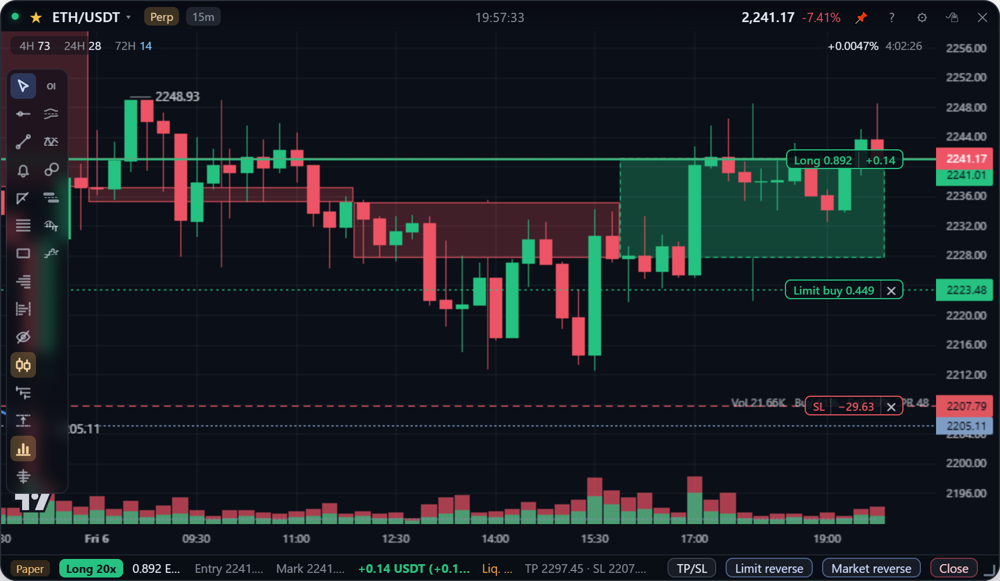
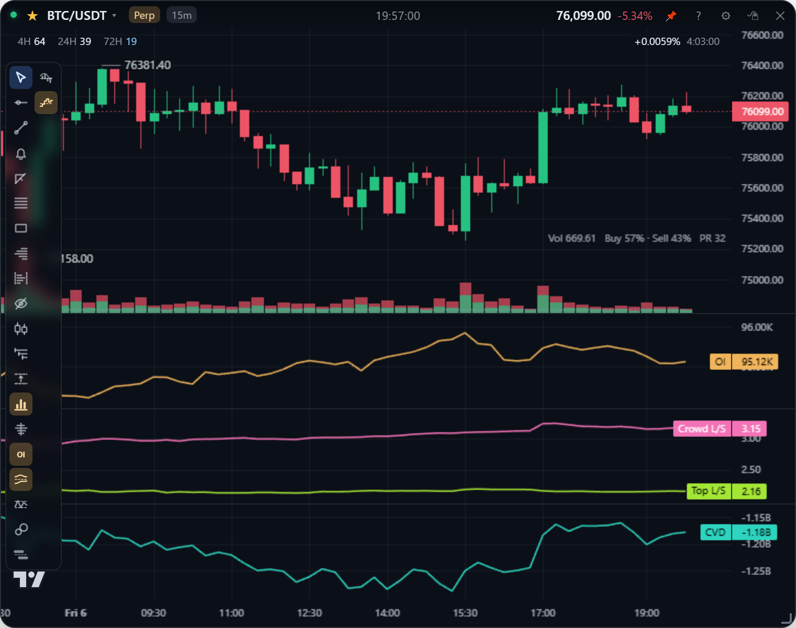
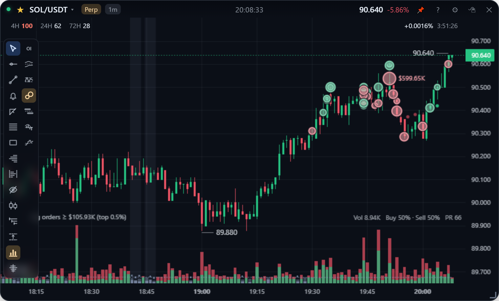
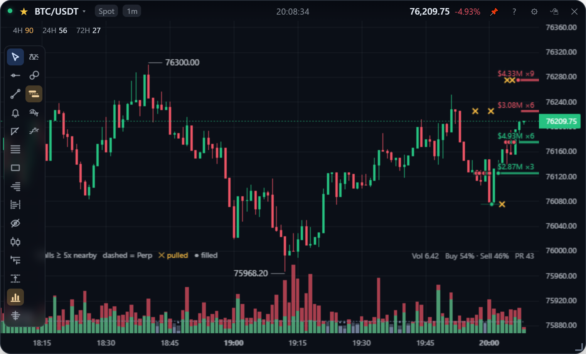
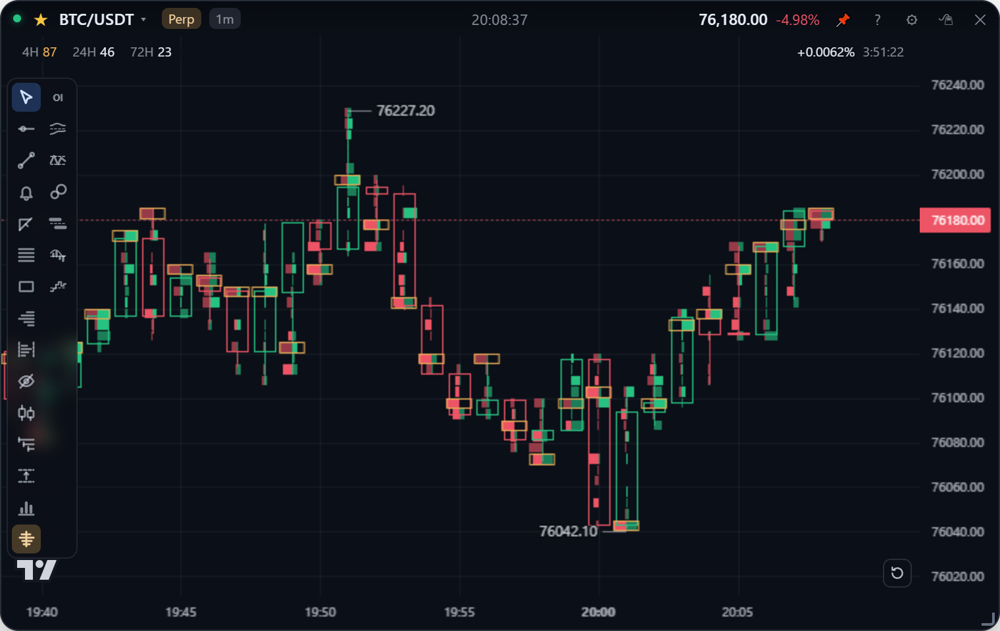
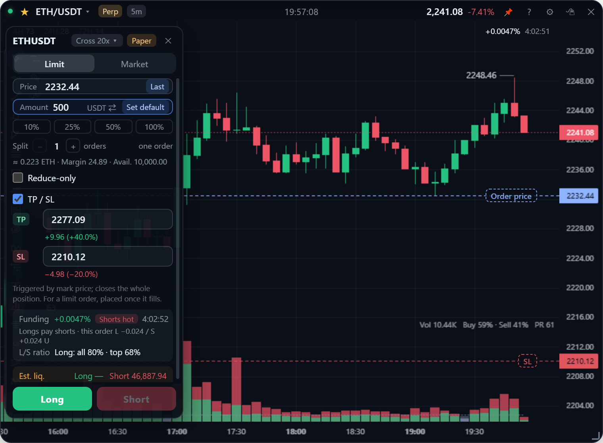
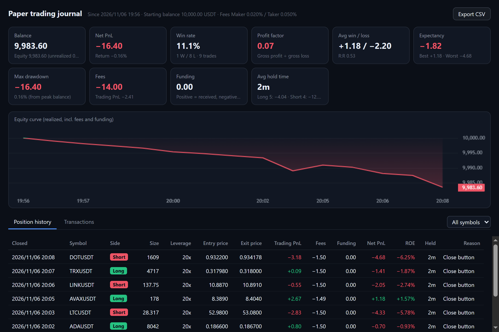

**English** | [繁體中文](README.zh-TW.md)

# TapeCard

*Formerly StockCard.* Translucent desktop chart cards for short-term crypto trading, run from the keyboard. Each card is a frameless, always-on-top window with a live Binance chart, spot or USDⓈ-M perpetual, and the order-flow tools to read it: CVD, the Coinbase premium, open interest, big orders, order-book walls, liquidations and a footprint. You can trade from the card too, on a local paper account, Binance's testnet or your own account.

**Electron 43 · TradingView Lightweight Charts v5 · Binance public market data** (no sign-up and no API key needed to chart)



## Highlights

| | |
| --- | --- |
|  |  |
| **CVD, open interest, long / short ratios.** Who is buying, who is opening, who is crowded. [Order flow →](docs/guide/order-flow.md) | **Big orders and the position read.** The top 0.1% of a coin's own orders, and whether longs or shorts are opening or closing. [Order flow →](docs/guide/order-flow.md#big-orders) |
|  |  |
| **Order walls.** Big resting orders drawn where they sit, and marked when pulled before price got there. [Order flow →](docs/guide/order-flow.md#order-walls) | **Footprint.** Taker buys and sells at every price inside each candle, exact from every trade. [Order flow →](docs/guide/order-flow.md#footprint) |
|  |  |
| **Trade from the chart.** Click a price, size it, press twice. Drag orders and TP / SL to reprice; reverse in one press. [Trading →](docs/guide/trading.md) | **Paper trading.** Your own starting balance on live data, with fees, funding, slippage and a journal. [Paper trading →](docs/guide/paper-trading.md) |

Also: drawing tools, daily / weekly / monthly opens and highs / lows, volume profiles, RSI and MACD, price, volume and range alerts that work with the cards hidden, US-stock and commodity perpetuals, a ten-symbol watchlist on `Alt+1`…`Alt+0`, mini-chart and ticker forms, and an English or Chinese interface.

## Quick start

Windows 10 / 11 and Node.js 22 or later (developed on 24).

```bash
npm install       # also copies lightweight-charts into renderer/vendor/
npm start         # run
npm run dev       # run, with the renderer console in the terminal
npm test          # the test suites (no network, no account)
npm run check     # syntax check of the whole tree + translation check
npm run dist      # Windows installer + portable build -> release/
```

On first launch a BTCUSDT 1-minute card opens. The app starts in English; to switch to Chinese open a card's settings (gear icon, or right-click) → Global settings → "語言 Language".

## Keys worth learning first

Press **`F1`** on any card for the full cheat sheet; type to filter it.

| Keys | Does |
| --- | --- |
| `Alt+1` … `Alt+0` | Switch to watchlist entry 1–10 |
| Double-click the chart | Add a horizontal level (`Ctrl` snaps to OHLC) |
| `Shift` + drag | Measure price, % and time |
| `Alt+A` | Price alert at the cursor |
| `Alt+R` | Reset the view to the latest bar |
| `Alt+H` | Hide / show all drawings |
| `Alt+M` / `Alt+T` | Shrink to a mini chart / a price ticker (again to restore) |
| `Ctrl+Z` | Undo a drawing change |
| `Esc` | Back to the cursor; cancels a drag or a half-drawn line |
| Long / Short, then `Enter` | Send the order (within 3 seconds) |
| `Ctrl+Alt+S` | Show / hide every card (global) |

## Documentation

| | |
| --- | --- |
| **User guide** | [Reading the chart](docs/guide/chart.md) · [Symbols & markets](docs/guide/markets.md) · [Drawing](docs/guide/drawing.md) · [Levels & volume profiles](docs/guide/levels.md) · [Order flow](docs/guide/order-flow.md) · [Alerts](docs/guide/alerts.md) · [Trading](docs/guide/trading.md) · [Paper trading](docs/guide/paper-trading.md) · [Cards & windows](docs/guide/windows.md) |
| **Design** | [Architecture](docs/design/architecture.md) · [Data sources](docs/design/data-sources.md) · [Storage](docs/design/storage.md) · [Analytics](docs/design/analytics.md) · [Trading internals](docs/design/trading.md) · [Footprint](docs/design/footprint.md) |
| **Help** | [Vanishing cards](docs/troubleshooting/vanishing-cards.md) · [All documentation](docs/README.md) · [Contributing](CONTRIBUTING.md) · [Changelog](CHANGELOG.md) |

## Trading and your keys

Charting needs no account. Trading is optional, and its default is **Binance demo trading (testnet)**; live needs an extra confirmation.

- Give the API key only **Reading** and **Futures trading**, **never withdrawals**, and restrict it to your IP.
- The secret or private key is encrypted with Windows DPAPI in `%APPDATA%/stock-card/`, outside this repository, and readable only by the app's main process under your Windows account. Pages see only its last four characters.
- Every order is rounded to the exchange's rules in the main process and needs two presses to send.

Details: [Trading](docs/guide/trading.md#setup) and [Trading internals](docs/design/trading.md#keys).

## License

MIT. Charts use [TradingView Lightweight Charts](https://github.com/tradingview/lightweight-charts) (Apache-2.0); the TradingView logo on the chart is its attribution. Market data comes from Binance's public API; nothing is scraped from TradingView's website. Trading real funds is entirely at your own risk, and nothing in this project is financial advice.
