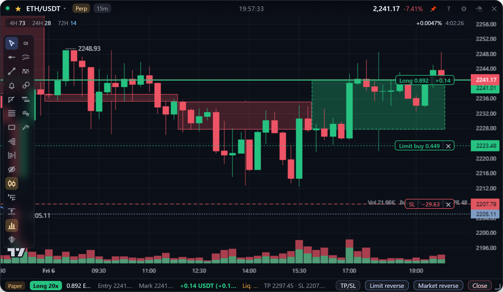
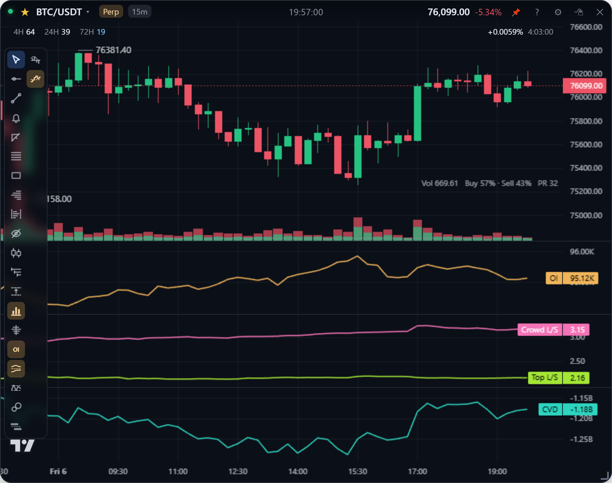
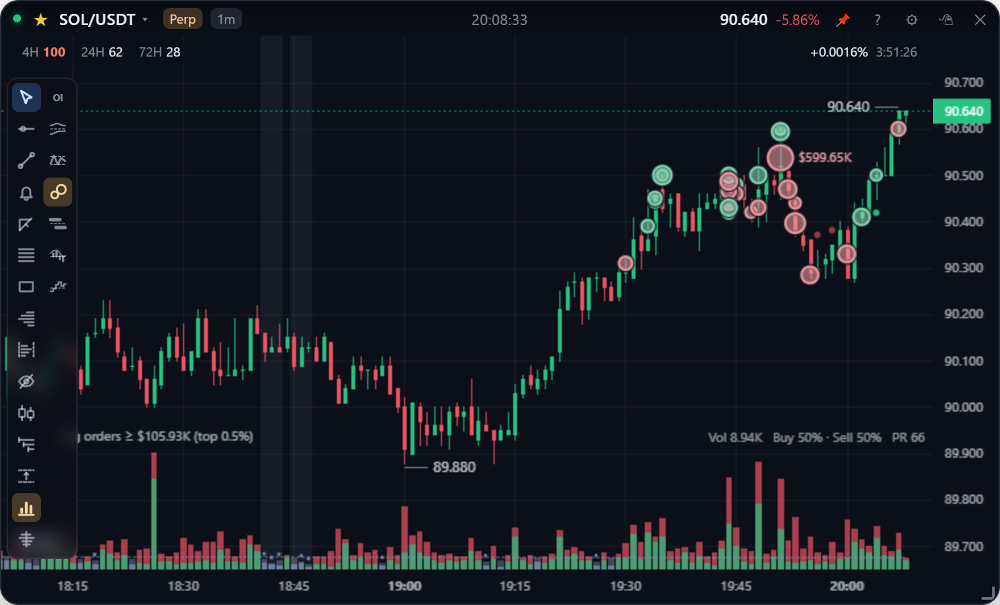
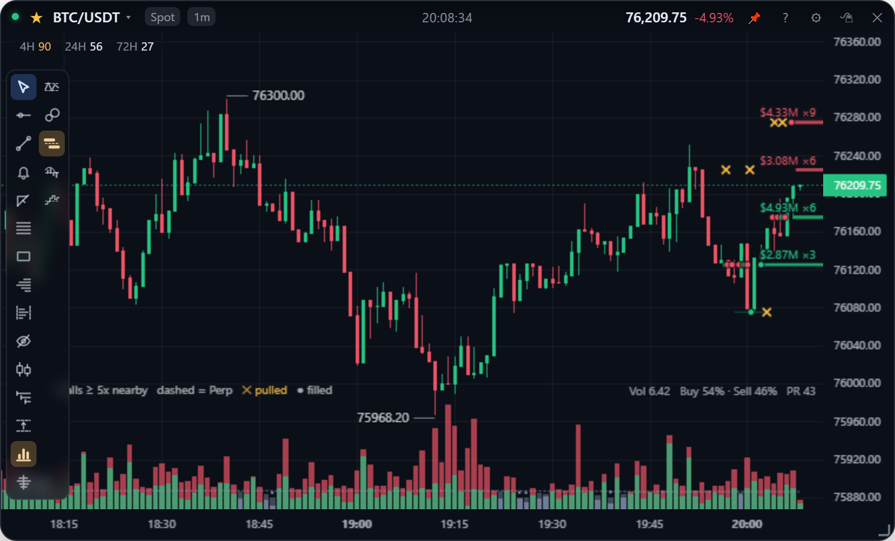
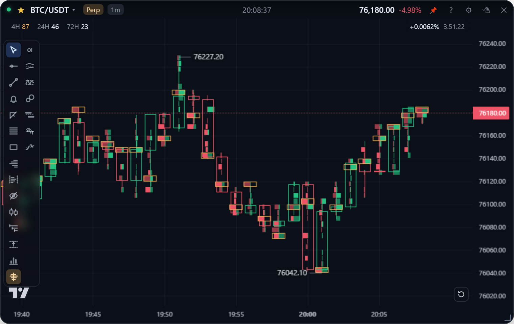
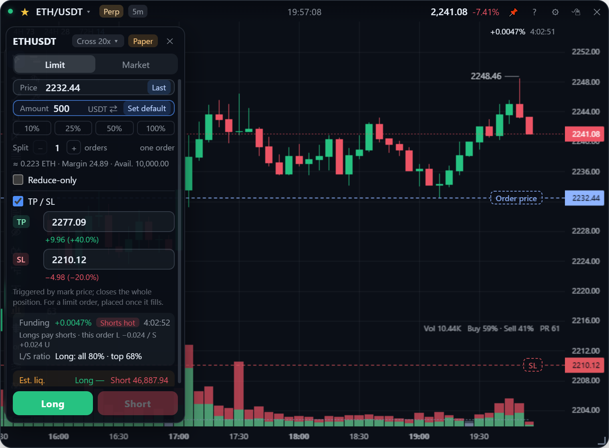
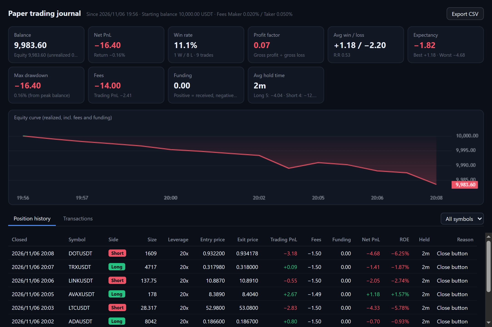

[English](README.md) | **繁體中文**

# TapeCard

*舊名 StockCard。* 給短線加密貨幣交易用、以快捷鍵操作的半透明桌面看盤卡片。每張卡片是一個無邊框、可置頂的視窗，顯示幣安的即時線圖（現貨或 U 本位永續），並附上判讀用的訂單流工具：CVD、未平倉量、大單、掛單牆、清算和足跡圖。也可以直接在卡片上交易：本機模擬帳戶、幣安測試網，或你自己的帳戶。

**Electron 43 · TradingView Lightweight Charts v5 · 幣安公開行情**（看盤免註冊、免 API Key）



## 功能亮點

| | |
| --- | --- |
|  |  |
| **CVD、未平倉量、多空比**：誰在買、誰在開倉、哪一邊太擠。[訂單流 →](docs/guide/order-flow.zh-TW.md) | **大單與倉位判讀**：該幣種前 0.1% 的單，以及是多單還是空單在進場或離場。[訂單流 →](docs/guide/order-flow.zh-TW.md#大單) |
|  |  |
| **掛單牆**：大掛單畫在它所在的價位，價格還沒到就被撤掉的會標出來。[訂單流 →](docs/guide/order-flow.zh-TW.md#掛單牆) | **足跡圖**：每根 K 棒內每個價位的主動買賣，用每一筆成交算出的精確值。[訂單流 →](docs/guide/order-flow.zh-TW.md#足跡圖) |
|  |  |
| **在圖上交易**：點價位、填金額、按兩下。拖曳掛單和止盈止損改價，一鍵反手。[下單 →](docs/guide/trading.zh-TW.md) | **模擬交易**：自訂初始資金、用即時行情撮合，算進手續費、資金費和滑價，附交易紀錄。[模擬交易 →](docs/guide/paper-trading.zh-TW.md) |

還有：畫圖工具、日／週／月開盤價與高低點、成交量分布、RSI 與 MACD、卡片隱藏時也會響的價格／成交量／位置提醒、美股與商品永續、`Alt+1`…`Alt+0` 切換的十個常用幣種、迷你 K 線與價格條，以及中英文介面。

## 快速開始

Windows 10 / 11，Node.js 22 以上（開發用的是 24）。

```bash
npm install       # 同時把 lightweight-charts 複製到 renderer/vendor/
npm start         # 執行
npm run dev       # 執行，並把 renderer 的 console 轉到終端機
npm test          # 測試（不連網路、不碰帳戶）
npm run check     # 全樹語法檢查 + 介面翻譯檢查
npm run dist      # 打包成 Windows 安裝檔 + 免安裝版 -> release/
```

第一次啟動會開一張 BTCUSDT 1 分 K 線卡片。App 預設是英文介面；要換成中文，打開卡片的設定（齒輪鈕或右鍵）→ 全域設定 →「語言 Language」。

## 最值得先記的按鍵

在任一張卡片上按 **`F1`** 看完整的總表，打字就能篩選。

| 按鍵 | 作用 |
| --- | --- |
| `Alt+1` … `Alt+0` | 切換到常用幣種第 1～10 個 |
| 雙擊圖表 | 新增水平線（加 `Ctrl` 吸附開高低收） |
| `Shift` + 拖曳 | 量測價差、漲跌幅與時間 |
| `Alt+A` | 在游標價格設價格提醒 |
| `Alt+R` | 重置視圖，回到最新 K 棒 |
| `Alt+H` | 隱藏／顯示所有繪圖 |
| `Alt+M` / `Alt+T` | 縮成迷你 K 線／價格條（再按一次還原） |
| `Ctrl+Z` | 撤銷繪圖的變更 |
| `Esc` | 回到游標；取消拖曳或畫到一半的線 |
| 做多／做空後按 `Enter` | 送出委託（3 秒內） |
| `Ctrl+Alt+S` | 顯示／隱藏全部卡片（全域） |

## 文件

| | |
| --- | --- |
| **使用手冊** | [看盤基本操作](docs/guide/chart.zh-TW.md) · [幣種與市場](docs/guide/markets.zh-TW.md) · [畫圖](docs/guide/drawing.zh-TW.md) · [關鍵價位與成交量分布](docs/guide/levels.zh-TW.md) · [訂單流](docs/guide/order-flow.zh-TW.md) · [提醒](docs/guide/alerts.zh-TW.md) · [下單](docs/guide/trading.zh-TW.md) · [模擬交易](docs/guide/paper-trading.zh-TW.md) · [卡片與視窗](docs/guide/windows.zh-TW.md) |
| **設計文件** | [架構](docs/design/architecture.zh-TW.md) · [資料來源](docs/design/data-sources.zh-TW.md) · [資料儲存](docs/design/storage.zh-TW.md) · [分析指標](docs/design/analytics.zh-TW.md) · [交易內部設計](docs/design/trading.zh-TW.md) · [足跡圖](docs/design/footprint.zh-TW.md) |
| **其他** | [卡片消失排查](docs/troubleshooting/vanishing-cards.zh-TW.md) · [全部文件](docs/README.zh-TW.md) · [貢獻指南](CONTRIBUTING.zh-TW.md) · [變更紀錄](CHANGELOG.zh-TW.md) |

## 交易與你的金鑰

看盤不需要帳戶。交易是選用的，預設是**幣安模擬交易（測試網）**，切到正式環境需要另外確認。

- API Key 只給**讀取**和**合約交易**權限，**絕對不要開提現**，並綁定你的 IP。
- Secret 或私鑰用 Windows DPAPI 加密，存在 `%APPDATA%/stock-card/`，不在這個 repo 裡，而且只有 App 的主行程在你的 Windows 帳戶下讀得到。畫面只看得到末四碼。
- 每一筆委託都在主行程依交易所規則取整，而且要按兩下才會送出。

細節見[下單](docs/guide/trading.zh-TW.md#設定)和[交易內部設計](docs/design/trading.zh-TW.md#金鑰)。

## 授權

MIT。圖表使用 [TradingView Lightweight Charts](https://github.com/tradingview/lightweight-charts)（Apache-2.0），圖上的 TradingView 標誌是它的署名。行情資料來自幣安公開 API，本專案不抓取 TradingView 網站的任何資料。用真實資金交易的風險完全由你自行承擔，本專案的任何內容都不是投資建議。
