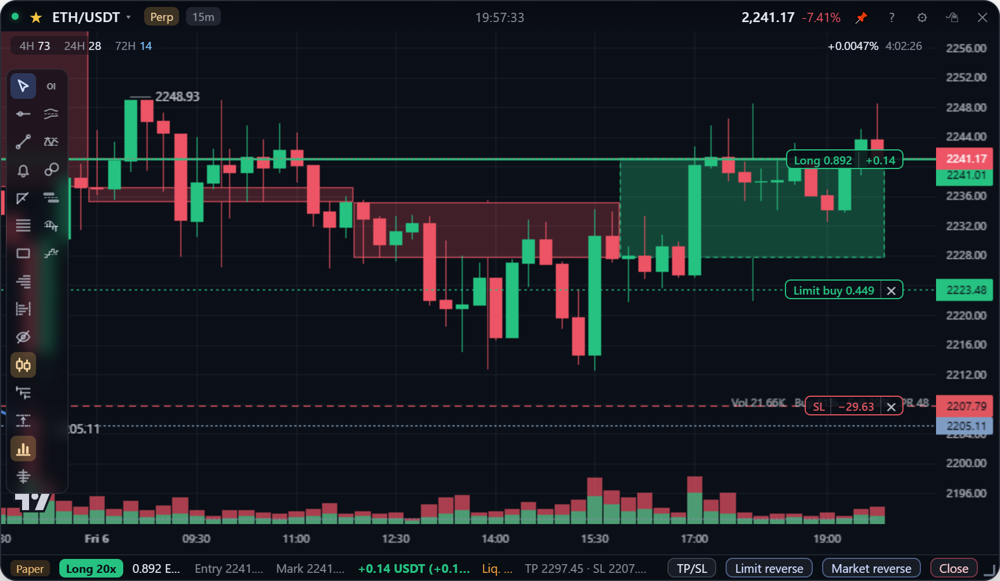
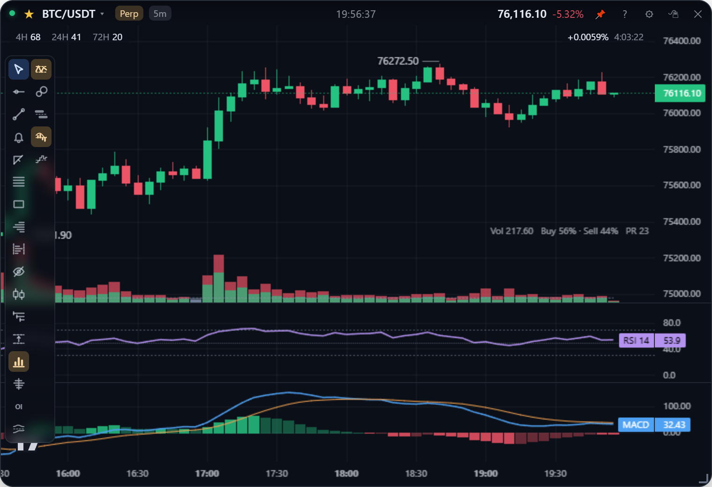

**English** | [繁體中文](chart.zh-TW.md)

# Reading the chart

How to move around a card's chart: zooming, panning, the crosshair, the prices and times it shows, the higher-timeframe overlay and the RSI / MACD panes. Drawing tools are in [Drawing](drawing.md); volume, CVD, open interest and the other order-flow panes are in [Order flow](order-flow.md).

## Zoom and pan

| Action | How |
| --- | --- |
| Zoom time | Mouse wheel on the chart, or drag the time axis. The right edge stays where it is, as on TradingView |
| Zoom price | Mouse wheel or drag up / down **on the price axis**. Stretching it turns autoscale off; from then on dragging the chart pans freely in any direction |
| Autoscale back on | Double-click the price axis |
| Reset the view | The reset button that appears where the two axes meet, or `Alt+R`. Restores autoscale and the default bar width and jumps back to the latest bar in one step, however far back you are |

Zoomed all the way out a candle is a tenth of a pixel, little more than its high-low line, so a wide card shows about a month of 5m bars. Older history loads in pages as wide as the screen until the view is filled; it comes from the local bar cache first and the exchange second (see [Storage](../design/storage.md)).

## The crosshair

The crosshair follows the cursor freely, and the price axis shows the price under it. Hold `Ctrl` and it snaps to the open, high, low or close **nearest the cursor**: the high when you are above the bar, the low below it.

This deliberately matches TradingView: free by default, magnet only with `Ctrl`, and the magnet goes to the nearest OHLC rather than only the close (lightweight-charts' `CrosshairMode.MagnetOHLC`). Use it to put a level exactly on a wick.

## Prices on the chart

- **Last price.** The label and dashed line on the price axis always show the **latest** bar's price, even while you look at history. When it is off screen the label is pinned to the top or bottom of the axis as `▲ price` / `▼ price`.
- **Visible high and low.** The highest and lowest points on screen are tagged with their price (candles use high / low; line and area charts use the close) and move as you scroll or zoom.
- **Funding rate.** On perpetual cards, the top right of the chart shows the current funding rate and a countdown to the next settlement, ticking every second. See [Symbols & markets](markets.md).

## Time

- **Time zone.** Settings → "Time zone": Local (the default), Taipei or UTC. Binance timestamps are UTC; this changes how they are **printed**, not the timestamps themselves, which the datafeed also uses to de-duplicate backfills and update the forming bar.
- **Daily candles** follow Binance's UTC day, so in UTC+8 a `1d` candle is labelled 08:00. That is how the exchange splits days, not a display bug.
- **Weekdays.** Each new day on the time axis carries its weekday (`Sun 25`), and the crosshair label shows the full date with it (`Sun, Oct 25, 15:25`).
- **Clock.** The title bar shows the time to the second (`HH:MM:SS`) in the chart's time zone. Settings → Global settings → "Title bar clock": **Always** (the default), **On hover**, or **Off**. When the title bar is showing, the clock moves into the gap between symbol and price if the centre is taken, and steps aside on cards too narrow for a gap (about 450px and below).

## Higher-timeframe overlay

The toolbar icon with two candles opens a menu: Off / **1H / 4H / 1D / 1W (7 days)**. The last 50 candles of that interval are drawn as translucent boxes behind the card's own candles; the one still forming has a dashed outline and reshapes with live prices. 1D and 1W follow Binance's UTC days and weeks (a week opens Monday 00:00 UTC). The choice is per card.

The overlay only appears on intervals below the one chosen (4H on 1m–1h, 1D on up to 4h, and so on): on a chart of the same interval the box would be the candle itself. The forming box is fed by its own subscription on that interval rather than built from the card's bars, because a 1m card holds only about eight hours and the exchange's own candles are the authoritative values.

## RSI and MACD

Two icons in the lower half of the toolbar:

- **RSI** (a line between two dashed bounds) opens a menu: Off / Show RSI, and the length 7 / 14 / 21. The pane is fixed at 0–100 with dashed lines at 70 and 30.
- **MACD** (a histogram under a line) toggles a 12 / 26 / 9 pane: the MACD line (blue), the signal (orange) and the histogram, bright while it grows away from zero and dim while it shrinks.

Both update tick by tick and match TradingView's built-ins. Sub-panes together take at most half the card, so the candles keep the majority. How they are computed: [Analytics](../design/analytics.md#rsi-and-macd).

## The toolbar

Hover the card and a toolbar slides out on the left: cursor, horizontal line, trend line, price alert, measure, Fib retracement, rectangle, volume profile, fixed range volume profile, hide drawings, higher-timeframe overlay, opens, highs / lows, volume, footprint, OI, long / short ratio, RSI, big orders, order walls, MACD and CVD (OI and the long / short ratio are perpetual-only and hidden on spot cards). Click a drawing tool again to deselect it; `Esc` always returns to the cursor and cancels a half-drawn line.

- The toolbar follows the same rule as the title bar: it shows while the mouse is over the card and fades when it leaves. There is no separate "near the left edge" rule, because a card this small should not have two ways to summon its controls, and the outermost 20px of a translucent card is the hardest place to aim.
- It overlays the chart and takes no width when idle. Once you pick a tool, its icon stays visible after the rest fades, so you can tell you are still in drawing mode.
- On a card too short for one column it wraps into a second column instead of being cut off (a card at the default 220px height has two).
- **Gestures work in any mode** (double-click for a level, `Shift`-drag to measure). The toolbar is there so the gestures can be found, the same division of labour as on TradingView.

## Interface language

The app starts in English. Settings (gear icon or right-click) → Global settings → "語言 Language" switches between 中文 and English; the cards, the board and the journal reload while the market connections in the background stay up. How the translation works is in [Architecture](../design/architecture.md#interface-language).
