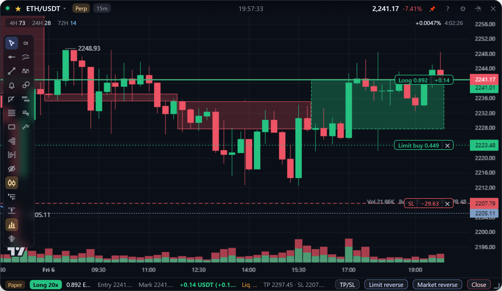
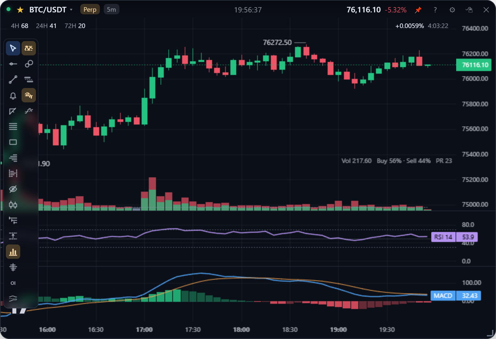

[English](chart.md) | **繁體中文**

# 看盤基本操作

怎麼在卡片的圖表上移動：縮放、平移、十字線、圖上顯示的價格和時間、大週期疊圖，以及 RSI / MACD 副圖。畫圖工具在[畫圖](drawing.zh-TW.md)；成交量、CVD、未平倉量等訂單流副圖在[訂單流](order-flow.zh-TW.md)。

## 縮放與平移

| 動作 | 方式 |
| --- | --- |
| 縮放時間 | 在圖上滾輪，或拖曳下方時間軸。右邊界固定不動，跟 TradingView 一樣 |
| 縮放價格 | 在**右側價格軸**上滾輪或上下拖曳。拉伸後自動縮放會關閉，之後在圖上拖曳可以上下左右自由平移 |
| 恢復自動縮放 | 雙擊價格軸 |
| 重置視圖 | 兩軸交角出現的重置鈕，或按 `Alt+R`。恢復自動縮放和預設 K 棒寬度，**一次**跳回最新 K 棒，不管往回拉多遠 |

縮到最小時一根 K 棒只有 0.1 像素，幾乎只剩高低點的線，寬一點的卡片可以看到約一個月的 5m。更早的歷史會以一個畫面寬的份量分批補上，直到填滿畫面；先查本機的 K 線快取，再向交易所抓（見[資料儲存](../design/storage.zh-TW.md)）。

## 十字線

十字線平常自由跟著游標走，右側價格軸即時顯示游標所在價位。按住 `Ctrl` 會吸到**離游標最近的**開、高、低、收：在 K 棒上方吸 high、下方吸 low。

這是刻意對齊 TradingView：平常自由，`Ctrl` 才啟動磁吸，而且磁吸目標是最近的 OHLC，不是只有收盤價（lightweight-charts 的 `CrosshairMode.MagnetOHLC`）。要把支撐壓力線放在影線上時用這個。

## 圖上的價格

- **最新價格**：價格軸上的價格標籤和虛線永遠是**最新一根**的價格，往回看歷史時也一樣。最新價不在畫面內時，標籤固定在價格軸頂端或底端，顯示 `▲ 價格` / `▼ 價格`。
- **畫面高低點**：目前畫面內的最高點和最低點會自動標出價格（K 線看最高價 / 最低價，折線與面積圖看收盤價），捲動或縮放時即時更新。
- **資金費率**：永續卡片在圖表右上角顯示目前資金費率和距離下次結算的倒數，每秒更新。見[幣種與市場](markets.zh-TW.md)。

## 時間

- **時區**：設定 →「時間顯示」可切本機（預設）/ 台北 / UTC。Binance 的時間戳是 UTC；這裡改的是**顯示格式**，不是時間戳本身，因為時間戳同時是 datafeed 回補去重和更新未收盤 K 棒的依據。
- **日 K** 依幣安的 UTC 日界切分，所以在 UTC+8 下 `1d` 會標成 08:00。這是交易所的切分方式，不是顯示錯誤。
- **星期幾**：時間軸上每一天的刻度都標星期幾（`25日 週日`），十字線的時間標籤也會顯示（`10月25日 週日 15:25`）。
- **時鐘**：標題列正中間顯示時間，精確到秒（`HH:MM:SS`），時區跟圖表一樣。設定 → 全域設定 →「標題列時鐘」：**一直顯示**（預設）、**滑鼠移上才顯示**、**關閉**。標題列內容出現時，正中間被幣種或價格佔到，時鐘會移到兩者之間的空隙；卡片太窄沒有空隙時（約 450px 以下）會暫時讓開。

## 大週期疊圖

工具列的兩根 K 棒圖示打開選單：關閉 / **1H / 4H / 1D / 1W（7 天）**。那個週期最近 50 根 K 棒以半透明方塊疊在卡片自己的 K 線後面；未收盤的那根是虛線框，會跟著即時報價變形。1D、1W 依幣安的 UTC 日、週切分（週線從週一 00:00 UTC 開始）。每張卡片各自記住。

只在比所選週期小的圖上顯示（4H 在 1m～1h、1D 在 4h 以下，依此類推）：在同週期的圖上，那個方塊就是 K 棒本身。未收盤的那根由那個週期的獨立訂閱餵養，而不是拿卡片的 K 棒聚合，因為 1m 卡片只有約 8 小時的資料，而交易所自己的 K 棒才是權威值。

## RSI 與 MACD

工具列下半部的兩個圖示：

- **RSI**（兩條虛線之間的一條線）打開選單：關閉 / 顯示 RSI，以及長度 7 / 14 / 21。副圖固定 0～100，70 與 30 畫虛線。
- **MACD**（線底下的柱狀圖）開關 12 / 26 / 9 副圖：MACD 線（藍）、訊號線（橘）和柱狀圖，柱子離零軸越來越遠時是亮色、縮回時是暗色。

兩者都逐筆即時更新，數值與 TradingView 內建指標相同。多個副圖加起來最多佔卡片一半高度，K 線保有大部分空間。計算方式見[分析指標](../design/analytics.zh-TW.md#rsi-與-macd)。

## 工具列

滑鼠移到卡片上，左側浮出工具列：游標、水平線、趨勢線、價格提醒、量測、斐波那契、矩形、成交量分布、區間成交量分布、隱藏繪圖、大週期疊圖、開盤價、高低點、成交量、足跡圖、未平倉量、多空比、RSI、大單、掛單牆、MACD 和 CVD（未平倉量和多空比只有永續，現貨卡片不顯示）。再點一次同一個畫圖工具可以取消；`Esc` 隨時回到游標，也會取消畫到一半的線。

- 工具列跟標題列的規則**完全相同**：滑鼠在卡片上就浮出，移開就淡掉。刻意不做成「靠近左邊緣才展開」：這麼小的卡片不該有兩套喚出介面的規則，而且半透明卡片最外緣 20px 是最難瞄準的地方。
- 工具列疊在圖表上，閒置時不佔寬度。選了工具之後，即使其他圖示淡掉，該工具的圖示仍會留著，你才知道自己還在繪製模式。
- 卡片太矮、一欄放不下時會**排成第二欄**，不會被切掉（預設 220px 高的卡片就是兩欄）。
- **手勢在任何模式下都有效**（雙擊加線、`Shift` 拖曳量測）。工具列是讓還沒背手勢的人也找得到，跟 TradingView 的分工一樣。

## 介面語言

App 預設是英文。設定（齒輪鈕或右鍵）→ 全域設定 →「語言 Language」切換中文 / English；卡片、看板和交易紀錄視窗會重新載入，背景的行情連線不會斷。翻譯的做法見[架構](../design/architecture.zh-TW.md#介面語言)。
