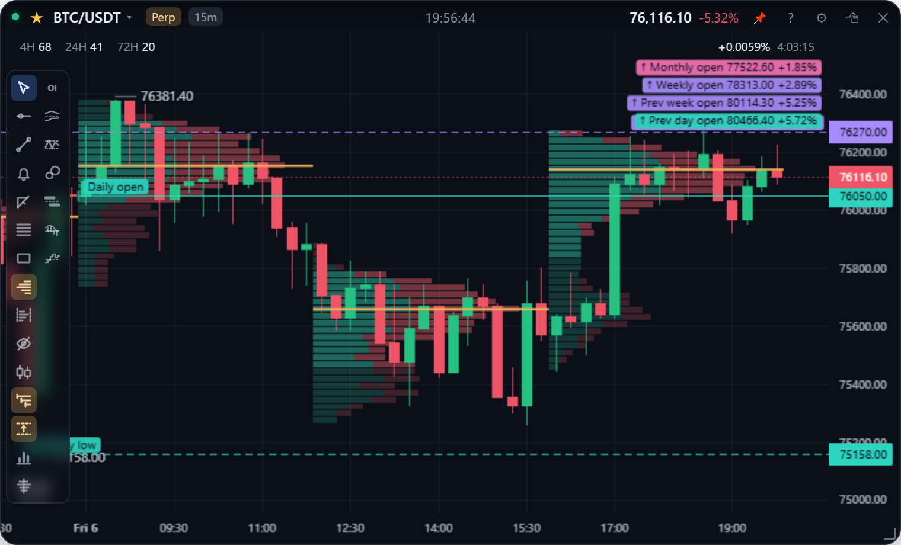
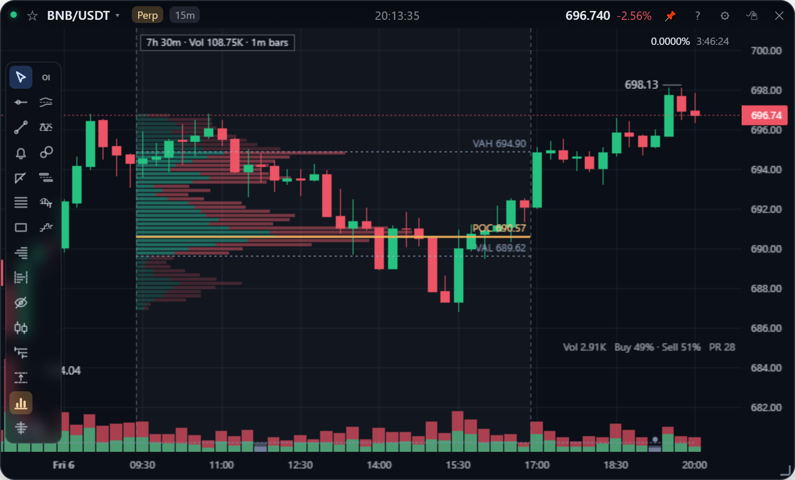

**English** | [繁體中文](levels.zh-TW.md)

# Levels & volume profiles

Reference levels the app draws for you: the opens and highs / lows of each day, week and month, and volume profiles over sessions or over a range you pick.

## Opens

The toolbar icon with **three lines pointing right**. Choose when a day starts:

| Option | Day starts at | Taiwan time (summer / winter) |
| --- | --- | --- |
| UTC 00:00 | The exchange's candle boundary | 08:00 |
| New York 00:00 | New York midnight (the "midnight open") | 12:00 / 13:00 |
| **NYSE open** | New York 09:30 | **21:30 / 22:30** |
| London 00:00 | London midnight | 07:00 / 08:00 |
| **LSE open** | London 08:00 | **15:00 / 16:00** |

The menu shows each in Taiwan time, tracking daylight saving. The "Show" part of the menu picks **Current**, **Previous** (yesterday's, last week's and last month's open: the same boundary one period back), or **Both**.

Daily (teal), weekly (purple) and monthly (pink) opens are drawn as solid lines from the opening bar to the right, with labels on the price axis. Lines off screen are pinned to the top or bottom right as "↑ Monthly open 92,500 +10.3%"; only the nearest four are shown.

- 20:30 Taiwan time in summer (08:30 New York) is when US economic data comes out, not the NYSE open.
- The UK and US change clocks on different dates (in 2026: UK 10/25, US 11/1), so for a week the two opens are only 5.5 hours apart. All of this is computed from the time zones by `Intl`, with no hard-coded offsets (`renderer/sessions.js`, covered by tests).
- **Weekends count as days**, since crypto trades on them, so Saturday also rolls over at 09:30. Weeks start on Monday and months on the 1st at the same time. Public holidays are not treated specially.

## Highs and lows

The toolbar icon with **two dashed lines, one above the other**: **Previous** (the previous day's, week's and month's high and low, dashed), **Current to date** (dotted, following live prices), or both. Lines start at the bar that set the high or low and use the same day boundary as the opens. The settings panel picks the boundary and which of daily, weekly and monthly to draw.

**How the lines read.** Colour means period (daily teal, weekly purple, monthly pink); line style means kind (opens solid, previous opens dash-dotted, previous highs / lows dashed, current highs / lows dotted). Labels such as "Prev day high" or "Week low" sit at the start, with "NY" or "LDN" added when not on UTC. They are deliberately unlike your own levels (grey-blue dashed lines across the whole chart). Lines at the same price merge into one, such as "Daily open · Weekly open" on a Monday.

The data comes from bars whose boundaries line up with the chosen start: 30-minute bars for the NYSE open (09:30 is not on the hour) and 1-hour bars otherwise, fetched from the start of the previous month and refetched at each new day.

## Volume profile

The volume profile icon opens a menu with three modes:

| Mode | What it shows |
| --- | --- |
| Per 4H session | Each 4H block (UTC 0/4/8/12/16/20, the exchange's 4h candles) gets its own profile and POC, growing left to right inside its block. Only on intervals below 1h |
| Visible range | The bars on screen, drawn against the right edge and recomputed as you pan and zoom |
| Today (UTC) | UTC 00:00 to now, drawn against the right edge |

**Detail** in the lower half of the menu sets each row's height on screen: Coarse 10px / Normal 6px / Fine 4px / Ultra fine 2px. Zooming in on the price axis therefore adds rows and shows a finer distribution.

Profiles are built the way TradingView builds its own, from 1m bars with each bar's volume spread over the prices it touched: an estimate, but a day costs two requests instead of hundreds. See [Analytics](../design/analytics.md#volume-profiles).

## Fixed range volume profile

TradingView's Fixed Range Volume Profile, for the ranges the chart decides rather than the clock: the run-up before a spike, the week of consolidation before a breakout, everything since a flush low.

| Action | How |
| --- | --- |
| Draw | Pick "Fixed range volume profile" (horizontal bars between two dashed lines) and **drag left or right**: only time counts, not the mouse height. The tool returns to the cursor when you finish |
| To now | Drag to the latest bar; it then updates every minute |
| Adjust | Drag the left or right edge |
| Move | Drag the label |
| Delete | Double-click an edge or the label; `Ctrl+Z` undoes |

The profile is drawn **teal for buys and red for sells**, the value area brighter, with the POC (solid orange) and VAH / VAL (dashed). The label above gives the length, the total volume and which bars it was computed from. Ranges are saved per symbol like rectangles and shared between spot and perp, each using its own market's volume.

- **Edges snap to whole bars**, and the bars at both ends are included.
- **It uses the finest bars that keep the range near 3,000 bars**: 1m up to two days, 5m for about ten days, 15m for a month. Finer bars spread each bar's volume over fewer rows, so the profile is closer to what really traded.
- **Rows follow the screen**: rows = the profile's height on screen ÷ Detail. The POC is the heaviest row, so finer rows put it on a narrower price and it may move when you change Detail.
- **Buys and sells** follow TradingView's up / down volume: a bar that closes at or above its open counts as buying. On 1m bars that split is quite informative.
- **The inside is not grabbable**, for the same reason as rectangles: ranges are wide and the inside is where you pan.
