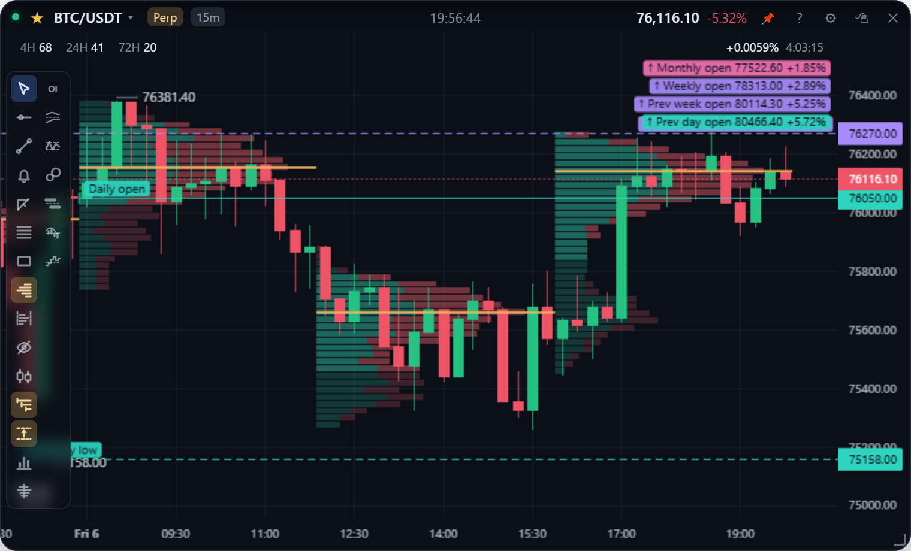
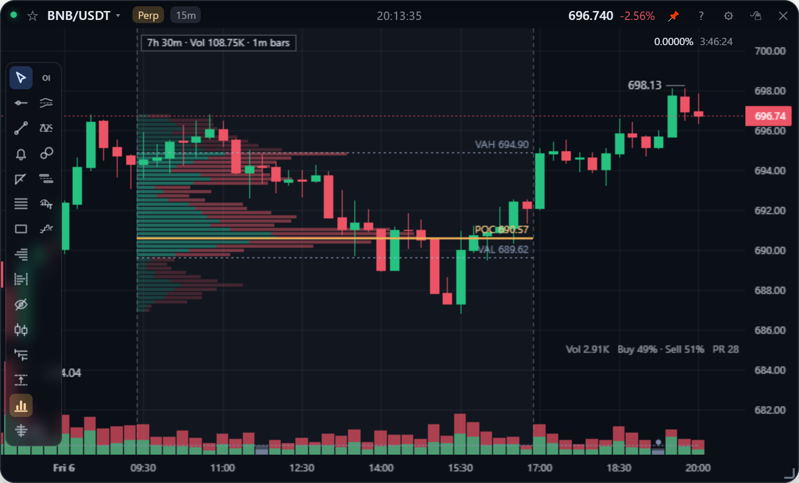

[English](levels.md) | **繁體中文**

# 關鍵價位與成交量分布

App 幫你畫的參考價位：每日、每週、每月的開盤價與高低點，以及依時段或依你選的區間算出的成交量分布。

## 開盤價

工具列的**三條往右的線**圖示。先選一天從什麼時候開始：

| 選項 | 一天的開始 | 台灣時間（夏令／冬令） |
| --- | --- | --- |
| UTC 00:00 | 交易所 K 棒的邊界 | 08:00 |
| 紐約 00:00 | 紐約午夜（midnight open） | 12:00／13:00 |
| **美股開盤** | 紐約 09:30 | **21:30／22:30** |
| 倫敦 00:00 | 倫敦午夜 | 07:00／08:00 |
| **英股開盤** | 倫敦 08:00 | **15:00／16:00** |

選單會寫出各自換算成台灣的時間，會跟著夏令時間變。選單下半部的「顯示」可以選**本期開**、**前期開**（昨日開、前週開、前月開，同樣的分界往前推一期），或**兩者**。

日開（青綠）、週開（紫）、月開（粉紅）畫成實線，從開盤那根 K 棒往右延伸，價格軸上有同色標籤。不在畫面內的會釘在右上或右下，顯示「↑ 月開 92,500 +10.3%」，只顯示最近的 4 個。

- 晚上 8:30（夏令）是美國經濟數據的公布時間（紐約 08:30），不是美股開盤。
- 英國和美國換時間的日期不同（2026 年英國 10/25、美國 11/1），中間那週兩個開盤只差 5.5 小時。這些都由 `Intl` 依時區計算，不寫死時差（`renderer/sessions.js`，有測試涵蓋）。
- **週末也算一天**，因為幣圈週末照常交易，所以週六一樣在 09:30 換日。週從週一、月從 1 號的同一時間開始。國定假日不另外處理。

## 高低點

工具列的**上下兩條虛線**圖示：**前一期**（前日、前週、前月的高低，虛線）、**本期至今**（點線，跟著即時報價更新）或兩者。線從創下高低點的那根 K 棒往右畫，分界時區跟開盤價相同。設定面板可以選分界時區，以及只畫日、週、月其中幾種。

**線怎麼看**：顏色代表週期（日青綠、週紫、月粉紅），線型代表種類（開盤實線、前期開盤點虛線、前一期高低虛線、本期高低點線）。起點有「前日高」「本週低」這類標籤，非 UTC 時加上「紐」「倫」。刻意跟自己畫的水平線（橫跨整張圖的灰藍色虛線）區分開。同價的線會合併，例如週一的「日開・週開」。

資料用分界剛好對齊所選時間的 K 棒：美股開盤 09:30 不是整點，用 30 分 K 棒；其他用 1 小時 K 棒。從上個月月初抓起，每到下一個日分界自動重抓。

## 成交量分布

點工具列的成交量分布圖示，選單有三種模式：

| 模式 | 內容 |
| --- | --- |
| 每 4H 分段 | 每個 4H 區塊（UTC 0/4/8/12/16/20 點，跟交易所的 4h K 棒同一個邊界）各自一組分布與 POC，在自己的時間區塊內由左往右長。只在 1h 以下的週期顯示 |
| 可見範圍 | 只算畫面上看得到的 K 棒，貼右邊畫，平移縮放時即時重算 |
| 本日 (UTC) | UTC 00:00 至今，貼右邊畫 |

選單下半部的**精細度**決定每一列在螢幕上的高度：粗 10px / 標準 6px / 細 4px / 極細 2px。所以放大價格軸時列數會變多，看得到更細的分布。

建置方式跟 TradingView 一樣：用 1 分 K 棒，把每根的量平均攤到它觸及的價格上。這是估計值，但一天只要兩次請求，而不是幾百次。見[分析指標](../design/analytics.zh-TW.md#成交量分布)。

## 區間成交量分布

就是 TradingView 的 Fixed Range Volume Profile，給「圖形決定、不是時鐘決定」的區間用：衝高前那段、突破前盤整的那一週、急跌低點以來。

| 動作 | 方式 |
| --- | --- |
| 畫 | 選「區間成交量分布」（兩條虛線夾著橫條的圖示），在圖上**左右拖曳**：只看時間，不看滑鼠高度。畫完工具會自動切回游標 |
| 至今 | 拖到最新的 K 棒，之後每分鐘更新 |
| 調整 | 拖左右邊線 |
| 移動 | 拖上方標籤 |
| 刪除 | 雙擊邊線或標籤；`Ctrl+Z` 可撤銷 |

分布以**青綠代表買、紅代表賣**，價值區較亮，並畫出 POC（橘實線）和 VAH / VAL（虛線）。上方標籤寫著長度、總量和用哪種 K 棒算的。跟矩形一樣依幣種儲存，現貨和永續共用，量用各自市場的。

- **邊界對齊整根 K 棒**，兩端的 K 棒都算進去。
- **用能讓區間在 3,000 根左右的最細 K 棒**：兩天以內用 1 分 K、十天左右用 5 分 K、一個月用 15 分 K。K 棒越細，每根的量攤到的列越少，分布就越接近真實成交。
- **列數跟著螢幕走**：列數 = 分布在螢幕上的高度 ÷ 精細度。POC 是最重的那一列，所以列切得越細，POC 會落在更窄的價位上，切換精細度時 POC 可能會移動。
- **買賣分色**跟 TradingView 的 up/down volume 一樣：收盤 ≥ 開盤的 K 棒算買。用 1 分 K 時這個切分相當有參考價值。
- **內部不能抓**，理由跟矩形一樣：區間通常很寬，內部是平移圖表的地方。
