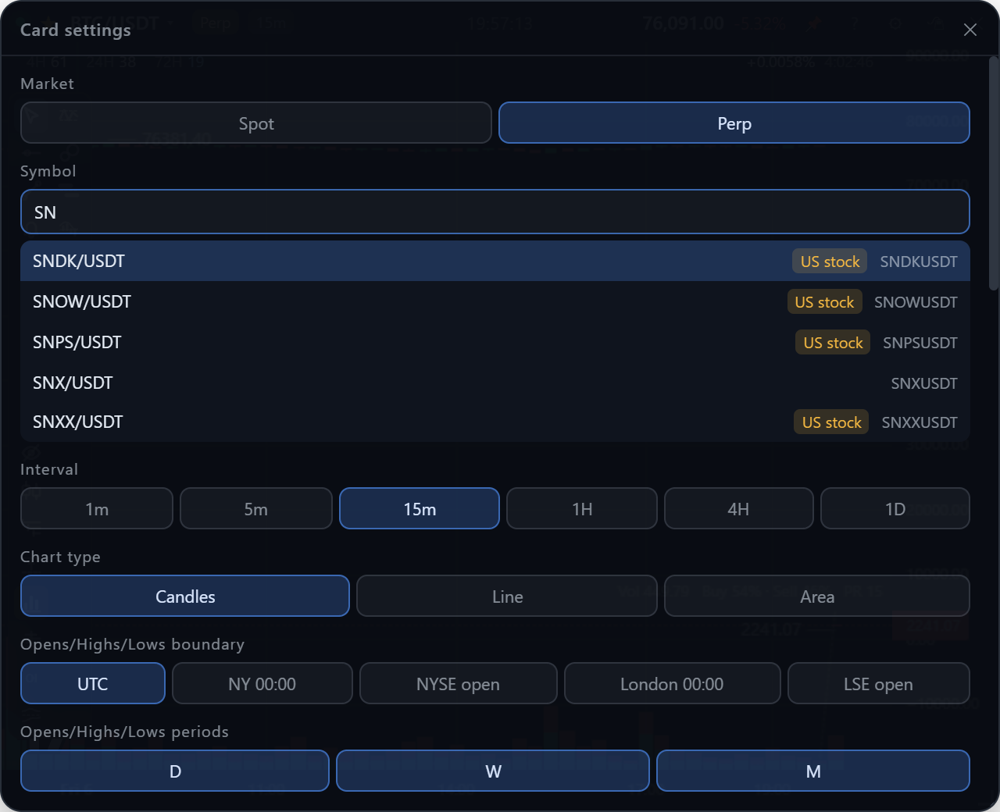
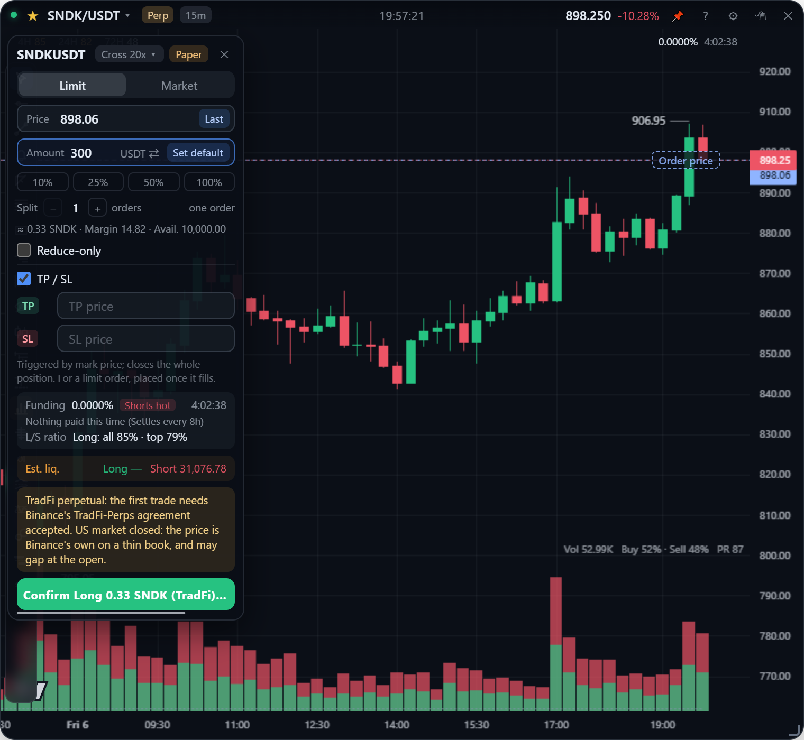
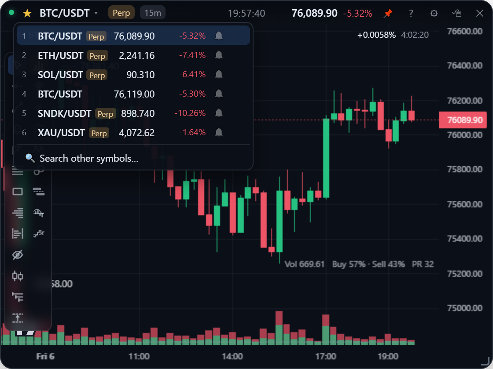

**English** | [繁體中文](markets.zh-TW.md)

# Symbols & markets

Picking a symbol, switching between spot and USDⓈ-M perpetuals, Binance's stock and commodity perpetuals, and the watchlist.

## Picking a symbol

Open the settings panel (gear icon or right-click the card) and type in the symbol field: it searches Binance's symbol list for the card's market (cached for 24 hours). For symbols you use every day, the [watchlist](#watchlist) is quicker.

## Spot and perpetual

Click the **Spot / Perp** tag right of the symbol name in the title bar to switch the card between the coin's spot market and its perpetual; the "Market" setting in the settings panel does the same.

Pairs named differently on the two markets are mapped automatically:

| Spot | Perp | Why the names differ |
| --- | --- | --- |
| `BTCUSDT` | `BTCUSDT` | Same name |
| `PEPEUSDT` | `1000PEPEUSDT` | The perp quotes 1,000 coins |
| `SNDKBUSDT` | `SNDKUSDT` | Tokenized stock: spot adds a trailing B (see below) |

If the other market has no such pair, the tag is grey and clicking it says why.

Perpetual cards also show:

- **Funding rate** at the top right of the chart (left of the price axis), with a countdown to the next settlement that ticks every second, between pushes and even while disconnected.
- The perpetual-only panes: open interest, the long / short ratios and the position read ([Order flow](order-flow.md)), and the ＋ that opens the order ticket ([Trading](trading.md)).

Drawings are shared by the two markets of a symbol; see [Drawing](drawing.md#where-drawings-are-kept).

## Stock & commodity perpetuals

Binance's TradFi perpetuals trade around the clock next to the crypto ones: US stocks (`NVDAUSDT`, `SNDKUSDT`), ETFs (`QQQUSDT`, `SOXLUSDT`), Hong Kong and Korean stocks, gold (`XAUUSDT`), oil and FX. They appear in the perp symbol search with a tag saying what they track:

| Tag | Binance's `underlyingType` |
| --- | --- |
| US stock | `EQUITY` |
| HK stock | `HK_EQUITY` |
| KR stock | `KR_EQUITY` |
| China A-share | `CN_EQUITY` |
| Commodity | `COMMODITY` |
| FX | `FX` |
| Pre-listing | `PREMARKET` |

Charts, CVD, OI, big orders and walls work as on crypto.

**Their spot side is the tokenized stock**, named with a trailing B: `SNDKUSDT` ↔ spot `SNDKBUSDT`, about a hundred of them, and the Spot / Perp tag switches between the two. Gold, oil, FX and stocks without a token have no spot pair, so the tag is grey.

**Ordering them** works like any perpetual, with three differences on the order ticket:

1. A note says whether the US market is open (Mon–Fri 9:30–16:00 New York time; market holidays are not known). Outside those hours the price is Binance's own, on a thin book, and it can gap when the market opens.
2. The confirm button names the asset as TradFi, e.g. "Confirm long 0.09 SNDK (TradFi) @ 1021.21".
3. Binance asks for its TradFi-Perps agreement to be accepted **in the Binance app** before the first order. The app does not sign it for you.

## Watchlist

The ☆ left of the symbol name adds the current symbol to the watchlist: up to 10, shared by all cards. The list remembers the market, so spot and perp of the same coin are two rows, the perp one marked.

| Action | How |
| --- | --- |
| Open the list | Click the **symbol name**: live prices and 24h change |
| Switch | Click a row (the market switches too) |
| Switch by key | `Alt+1` … `Alt+9` for entries 1–9 and `Alt+0` for the 10th, on the card clicked last. The digit left of each row is its key |
| Reorder | Drag a row; the others slide aside and the digit keys follow the new order |
| Remove | Hover a row and click ✕ |
| Mute alerts | 🔔 / 🔕 on the row (see [Alerts](alerts.md#range-alerts)) |

The keys run along the number row, so the first entry sits on the handy 1 and the tenth on 0. Watchlist symbols also get [range alerts](alerts.md#range-alerts), watched in the background even with no card open.
