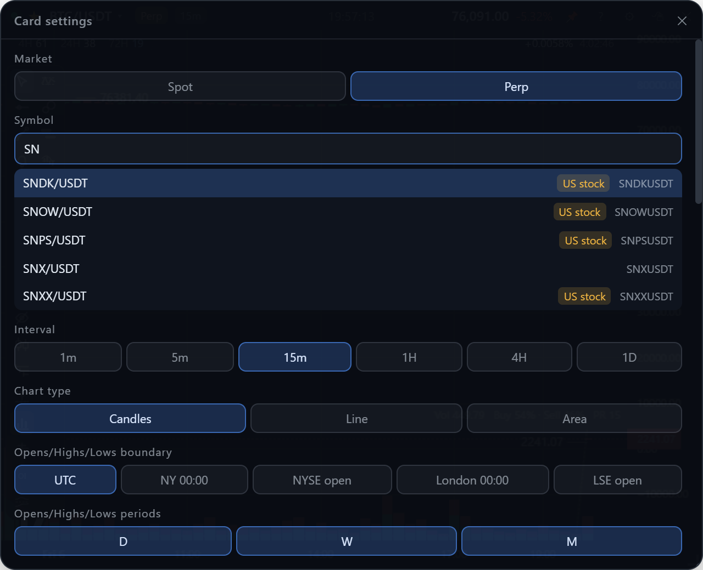
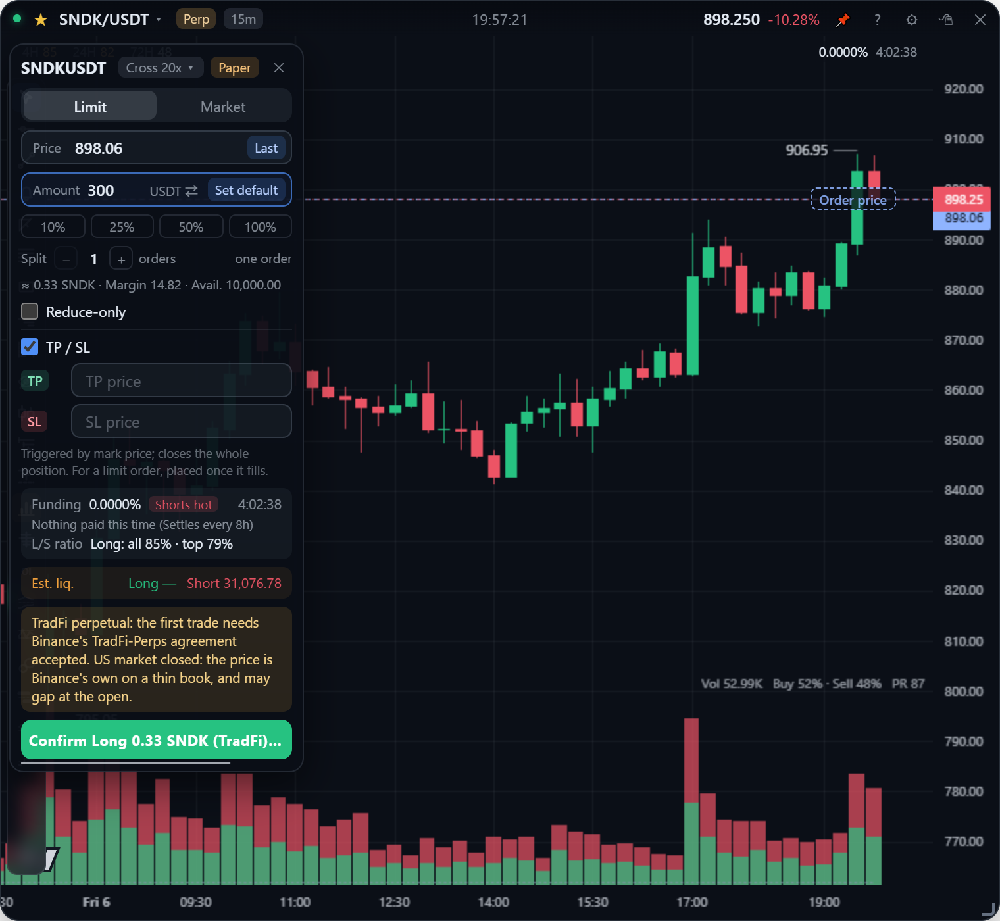
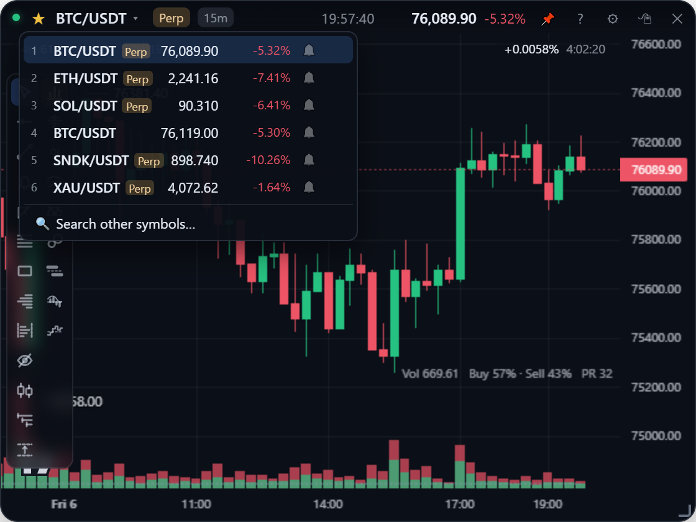

[English](markets.md) | **繁體中文**

# 幣種與市場

選幣種、在現貨與 U 本位永續之間切換、幣安的美股與商品永續，以及常用清單。

## 選幣種

打開設定面板（齒輪鈕或在卡片上按右鍵），在幣種欄位輸入：會在幣安這個市場的交易對清單裡搜尋（清單快取 24 小時）。每天都會用到的幣種，用[常用清單](#常用清單)比較快。

## 現貨與永續

點標題列幣種名稱右邊的「**現貨 / 永續**」標籤，在同一個幣的現貨與永續合約之間切換；設定面板的「市場」也可以切。

兩個市場名稱不同的交易對會自動對應：

| 現貨 | 永續 | 為什麼名稱不同 |
| --- | --- | --- |
| `BTCUSDT` | `BTCUSDT` | 同名 |
| `PEPEUSDT` | `1000PEPEUSDT` | 永續以 1,000 顆為單位報價 |
| `SNDKBUSDT` | `SNDKUSDT` | 代幣化股票：現貨名稱後面多一個 B（見下方） |

對面市場沒有這個交易對時，標籤會變灰，點了會說明原因。

永續卡片還會顯示：

- 圖表右上角（價格軸左邊）的**資金費率**，以及距離下次結算的倒數。倒數在卡片端每秒自己算，所以兩次推送之間、甚至斷線時也會繼續走。
- 只有永續才有的副圖：未平倉量、多空比和倉位判讀（[訂單流](order-flow.zh-TW.md)），以及開下單票的 ＋（[下單](trading.zh-TW.md)）。

同一個幣種的兩個市場共用繪圖，見[畫圖](drawing.zh-TW.md#繪圖存在哪裡)。

## 美股與商品永續

幣安的 TradFi 永續跟加密貨幣永續一樣 24 小時交易：美股（`NVDAUSDT`、`SNDKUSDT`）、ETF（`QQQUSDT`、`SOXLUSDT`）、港股、韓股、黃金（`XAUUSDT`）、原油和外匯。它們會出現在永續的幣種搜尋裡，並標上追蹤的市場：

| 標籤 | 幣安的 `underlyingType` |
| --- | --- |
| 美國股票 | `EQUITY` |
| 港股 | `HK_EQUITY` |
| 韓股 | `KR_EQUITY` |
| A 股 | `CN_EQUITY` |
| 商品 | `COMMODITY` |
| 外匯 | `FX` |
| 上市前 | `PREMARKET` |

線圖、CVD、OI、大單、掛單牆都和加密貨幣一樣能用。

**它們的現貨是代幣化股票**，名稱後面多一個 B：`SNDKUSDT` ↔ 現貨 `SNDKBUSDT`，約一百檔，用「現貨 / 永續」標籤就能切換。黃金、原油、外匯和沒有代幣的股票沒有現貨，標籤是灰的。

**下單**跟一般永續一樣，只有下單票上有三點不同：

1. 提示美股現在是否開盤（紐約時間週一到週五 9:30～16:00，不含國定假日）。休市時是幣安自己的報價、掛單少，開盤時可能跳空。
2. 確認按鈕會標明是傳統資產，例如「確認做多 0.09 SNDK（傳統資產）@ 1021.21」。
3. 第一次下單前，幣安要求先**在幣安 App** 同意 TradFi 永續的合約條款。App 不會替你簽署。

## 常用清單

標題列幣種名稱左邊的 ☆ 把目前的幣種加入常用清單：最多 10 個，所有卡片共用。清單會記住市場，同一個幣的現貨和永續是兩列，永續那列有標記。

| 動作 | 方式 |
| --- | --- |
| 打開清單 | 點**幣種名稱**：顯示即時價格與 24h 漲跌 |
| 切換 | 點一列（市場一起切） |
| 用快捷鍵切換 | `Alt+1` ～ `Alt+9` 是第 1～9 個，`Alt+0` 是第 10 個，作用在最後點過的卡片。每列左邊的數字就是它的快捷鍵 |
| 排序 | 拖曳某一列，其他列會讓開，數字快捷鍵跟著新順序 |
| 移除 | 滑到某列點 ✕ |
| 關閉提醒 | 該列的 🔔 / 🔕（見[提醒](alerts.zh-TW.md#位置提醒)） |

快捷鍵照鍵盤數字列的順序，所以第一個放在最順手的 1，第十個在 0。常用清單的幣種也會有[位置提醒](alerts.zh-TW.md#位置提醒)，就算沒開卡片也會在背景監控。
