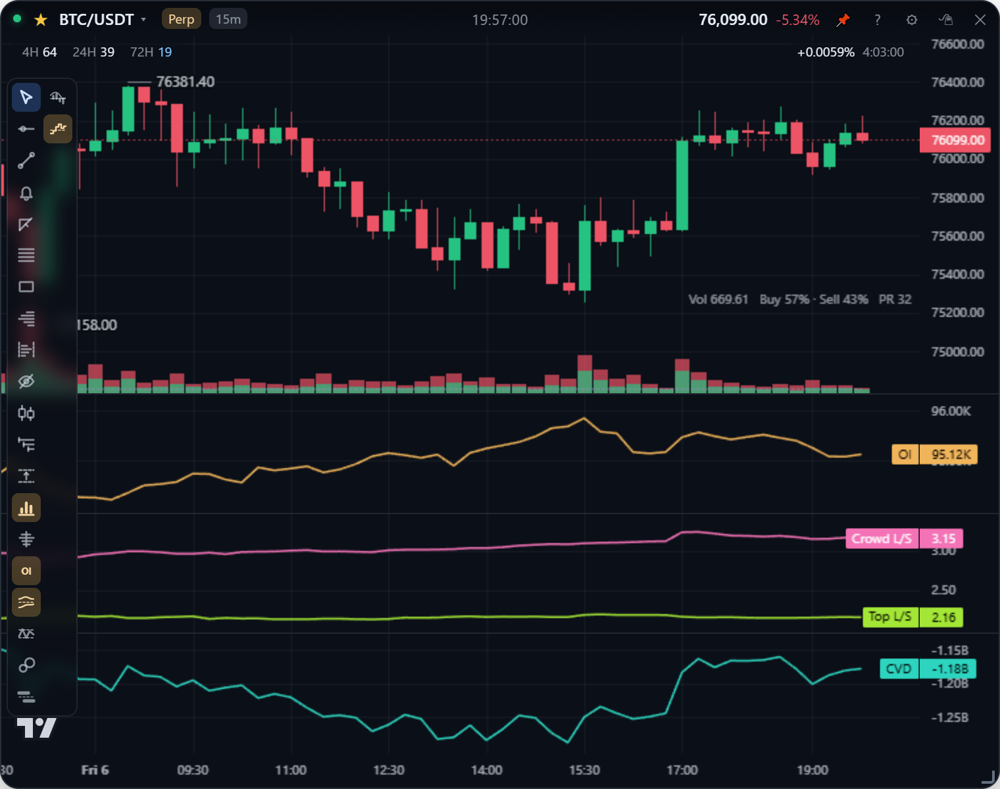
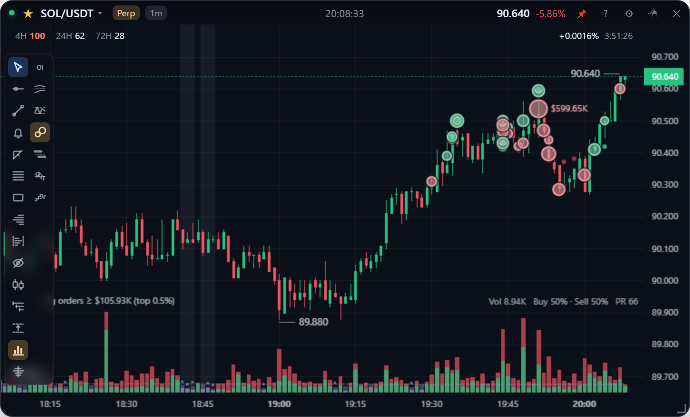
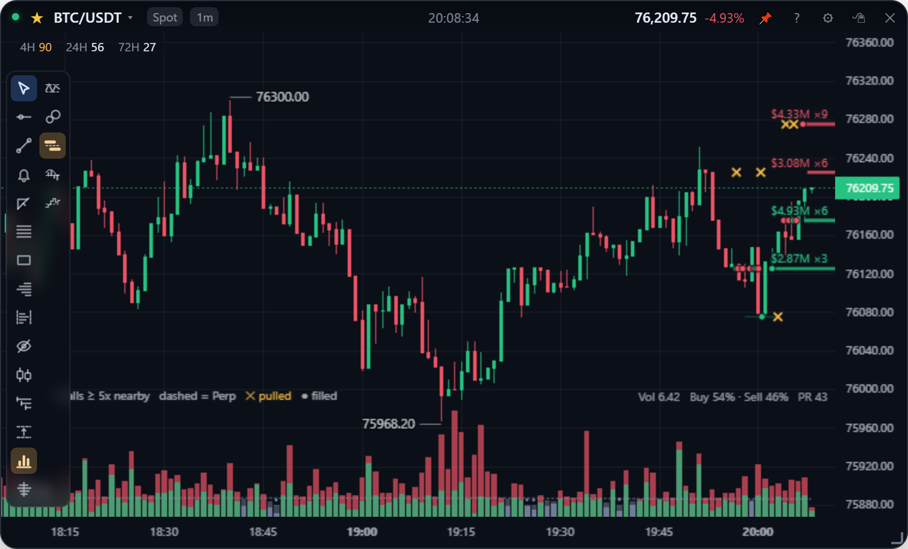
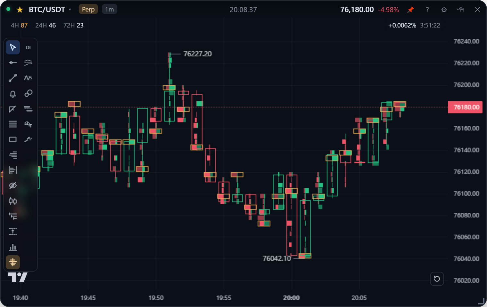

**English** | [繁體中文](order-flow.zh-TW.md)

# Order flow

Who is trading, and how hard: volume split into taker buys and sells, CVD, the Coinbase premium, open interest, the long / short ratios, big taker orders, the position read, order-book walls, liquidations and the footprint. Everything here comes from public data, free and with no API key: Binance's, Coinbase's for the premium, and for liquidations Bybit's and OKX's too.

| Tool | Spot | Perp | Toolbar icon |
| --- | :---: | :---: | --- |
| [Volume](#volume) | ✓ | ✓ | Bars |
| [CVD](#cvd) | ✓ | ✓ | Staircase |
| [Coinbase premium](#coinbase-premium) | ✓ | ✓ | Bars around a zero line |
| [Open interest](#open-interest-oi) | | ✓ | OI |
| [Long / short ratio](#long--short-ratio) | | ✓ | Two curves |
| [Big orders](#big-orders) | ✓ | ✓ | Two bubbles |
| [Position read](#position-read) | | ✓ | Two bubbles |
| [Order walls](#order-walls) | ✓ | ✓ | Two bars |
| [Liquidations](#liquidations) | ✓ | ✓ | Two triangles |
| [Footprint](#footprint) | ✓ | ✓ | A line with bars on both sides |

## Volume

The **bars** icon opens the volume menu: Off / Show volume, then:

- **Color.** "Taker buy / sell split" stacks taker buys (bottom) under taker sells (top). "Candle color" draws each bar whole in its candle's colour.
- **Position.** "Overlaid on the chart" (the default, as on TradingView, so the candles keep the card's full height) or "Separate pane".
- **Thin volume PR ≤.** A closed bar whose volume (in USDT) ranks at or below that percentile of the bars before it is drawn grey, so quiet bars stand out. A percentile rank rather than "under half the average", because one spike can be 10 to 50 times an ordinary bar and would drag an average around.
- **Distribution lookback.** About how many bars that distribution remembers; older bars fade out of it gradually.

## CVD

The **staircase** icon: off / show CVD, and where the sum starts.

- **From the first bar loaded.** Only the shape means anything: is buying keeping up with the price?
- **From 0 at each UTC midnight** (08:00 in Taiwan). The level is that day's net, with a dotted zero line and the line broken at each day.

Cumulative volume delta is taker buys minus taker sells, summed bar by bar. Binance sends the taker-buy volume with every kline, so it is free, on spot and perp alike. Each bar's delta is turned into USDT at its average price, like the volume bars (within about 1% of Binance's exact taker-buy quote volume). It updates tick by tick; bars from an old cache without the taker split add nothing.

## Coinbase premium

The **bars around a zero line** icon: Off / Premium + Coinbase CVD / Premium only / Coinbase CVD only. A pane of its own, for one question: is US spot money buying?

- **Bars: the premium.** How far Coinbase's dollar price is above (green) or below (red) Binance spot, in percent. Above zero, buyers on Coinbase are paying up, so US demand is leading. Binance quotes in USDT, which itself drifts a few hundredths of a percent off the dollar, about as much as the premium moves on a quiet day; so Binance's price is first turned into dollars at Coinbase's USDT-USD price. Charts that skip this step read a little differently. A perpetual card is read against its spot counterpart, which keeps the perpetual's basis out. The scale is centred on zero, so a bar's side and height read the same from one view to the next.
- **Blue line: Coinbase CVD.** Coinbase's taker buys minus taker sells, summed, in dollars; only its direction means anything. Coinbase's candles do not say who was the taker, so this comes from its trades. They are recorded for every symbol on screen while the app runs, whether or not the pane is on, and each time the app starts the last three hours are fetched back. Before that, the legend says *trades recorded from …*.
- **The legend** shows the hovered (or newest) bar's premium and Coinbase taker net buying.

It needs bars of a minute or longer, and a coin Coinbase trades in dollars (most large ones; the legend says when it has none).

**Reading it.** A rally with the premium above zero and Coinbase CVD rising has US spot buying behind it. A rally on Binance perpetuals with the premium below zero and Coinbase CVD flat or falling is led by offshore leverage alone, and has less underneath it.

**If Coinbase does not load.** Some networks, including some Taiwanese ISPs, block Coinbase's address at the DNS step, so it never answers. Tray menu → "Encrypted DNS (Cloudflare; reaches Coinbase)", on by default, makes the app look addresses up with Cloudflare or Google over HTTPS instead. Only the lookup changes: the connection still goes straight from your machine to the exchange (this is not a proxy or a VPN), nothing else on the machine is touched, and trading keeps the system's DNS. Whether to use it is your call; untick it in the same menu.

## Open interest (OI)

The **OI** icon (or settings → "Show open interest (OI) pane · Perp") adds an orange pane in coins (e.g. `94.90K` BTC), updated about every 3 seconds. Spot cards keep the setting and show the pane again when switched back to perp.

Binance publishes OI only as snapshots and a 5-minute history 30 days deep, so the app records it itself while a perp card is open, whether or not the pane is showing. Open the app at least once every 30 days and the history grows beyond the exchange's. How it is stored: [Storage](../design/storage.md#open-interest).

## Long / short ratio

The **two-curve** icon opens a menu: off / show, which lines, and the unit.

| Line | Colour | Meaning |
| --- | --- | --- |
| Crowd | Pink | Among accounts with a position, how many are net long, each account counted once: mostly retail |
| Top traders | Green | The top 20% of accounts by margin, by position size |

**Unit: share long % (the default).** Each line is the share long: a long/short ratio of 3 is 75%. The ratio stretches as it rises (2 → 3 looks like half again, but is 67% → 75% of accounts), so the share reads changes as they are. The crowd's line also gets:

- **7d base** (dashed) and a **band** (dotted): the median of the crowd's share over the week before, and two robust deviations either side. The crowd has a level of its own (it rarely left 48–76% on BTC and 65–80% on ETH over a month), so what says something is the distance from its usual, not the number itself.
- **Bars along the bottom: what the price does not explain.** Over a day the crowd mostly mirrors the price: it adds longs into falls and closes them into rallies. The bars are the part of the crowd's 24h change that the 24h price change does not account for, in standard deviations: **amber at +2σ and over** (far longer than the fall explains: genuinely crowded), **blue at −2σ and under** (far less long than usual for the move), grey in between. They need ten days of history behind an hour, so the first stretch of the 30 days has none.

Both are fitted on the hours before each hour only, so the history shows what the pane would have said at the time. They are hourly, whatever the card's interval, and refresh once an hour.

> **How to read it.** A crowd far above its base after a sharp fall is usually just buying the dip, and on 30 days of BTC that was followed by bounces as often as not. An amber bar says the crowd is longer than even that explains, which is the crowding a flush feeds on; a blue bar near a high is the crowd turning away, which preceded the drops in that month. It is context for the order flow, not a signal on its own. Details and measurements: [Analytics](../design/analytics.md#the-crowd-in-context).

**Unit: long/short ratio.** The exchange's two ratios as they are, on one scale with a dotted line at 1.0 where longs and shorts balance.

The data is Binance's public trading statistics: every 5 minutes, the last 30 days, perpetuals only (the icon is hidden on spot cards). Each bar shows the reading taken at its **close**, and the forming bar the newest one. Bars shorter than 5 minutes carry the latest reading; spans older than 30 days or never sampled are left blank rather than drawn flat.

The same two numbers, with the funding rate, are in the order ticket: see [Trading](trading.md#long--short-bias).

## Big orders

The **two-bubble** icon: Off / Big orders / Position read / Both.

Every taker trade printed in the same millisecond is one order. Orders in the top 0.5% … 0.01% **of the coin's own recent orders** (pick in the menu) are drawn as bubbles at their average price, green for buys and red for sells, sized by amount; the biggest carry it. The legend at the bottom left says what the threshold is in USDT right now (ETH top 0.1% ≈ $300–800K, ADA ≈ $50K).

A rank rather than a dollar amount, because a fixed amount means a handful of orders an hour on ETH and none at all on ADA. Big orders are collected only while the app runs and a card shows them; rebuilding them afterwards would mean downloading every trade. Details: [Analytics](../design/analytics.md#big-orders-and-the-position-read).

## Position read

On perpetuals, a bar whose change in OI is 2 / 3 / 5× the median is tagged:

| Tag | Takers | OI | Reading |
| --- | --- | --- | --- |
| **新多** L+ | Buying | Up | Longs opening |
| **新空** S+ | Selling | Up | Shorts opening |
| **空補** S− | Buying | Down | Shorts closing |
| **多平** L− | Selling | Down | Longs closing |

Hover a bar for its ΔOI, taker net volume, reading and biggest order. OI only moves when both sides of a trade open (up) or both close (down), so ΔOI says how much was opened or closed and the taker side says which way the aggressors leaned. Bars are read only where OI was sampled inside them, i.e. while the app was running; opening and closing within one bar offset each other.

## Order walls

The **two-bar** icon: Off / This market's book / Spot + perp.

Resting orders far larger than the price levels around them (5 / 10 / 20 times, in the menu) are drawn as a line at their price from when they appeared, green for bids and red for asks, thicker the bigger, labelled with their size and multiple. With "Spot + perp" the other market's walls are dashed and tagged.

When a wall goes it leaves a faint line ending in:

- an amber **✕**: it was **pulled** before price got there, or
- a **dot**: price **traded into** it.

A perpetual's book takes about a minute and a half to fill out; the legend says so meanwhile. Walls that lived under ten seconds are not recorded, because near the price market makers re-quote every few seconds. How walls are found: [Analytics](../design/analytics.md#order-walls).

## Liquidations

The **two-triangle** icon: Off / Recorded + estimated levels / Recorded only / Estimated only, and which bars to mark: the coin's top 10%, 5% or 2% of bars by liquidations.

Two layers, for two questions.

**What was forced out.** Liquidations on Binance, Bybit and OKX, summed per bar:

- **▼ under the low**: longs liquidated, a forced sell, in red;
- **▲ over the high**: shorts liquidated, a forced buy, in green.

Only bars among the coin's largest are marked, sized by the amount, and the largest carry it. Hover any bar for the longs and shorts liquidated in it and each exchange's share.

- **Recording starts by itself.** Every perpetual a card is open on is recorded, whether or not the layer is on, so the history is there when you want it. A spot card shows its perpetual's liquidations.
- **Only while the app runs.** No exchange gives liquidation history away, so before the first recording the legend says *recorded from …*. No triangles there means no record, not a calm market.
- **Binance undercounts in a cascade.** It sends at most one liquidation per symbol per second; Bybit and OKX send every one.

**Where the fuel is.** Against the right edge, behind the candles, an estimate of where the leverage opened in the last 30 days would be liquidated: longs below the price in red, shorts above in green. The nearest large pool on each side is named with its size and distance, for example *Est. short liquidations ≈$42M · 77,141 · +4.5%*, and pinned to the top or bottom edge when it is off screen. Price reaching a level clears it, live, and the whole estimate is rebuilt every five minutes.

It is an estimate from open interest, the taker split and assumed leverage, not exchange data: no exchange publishes where positions would be liquidated, and the paid heatmaps estimate the same way. Positions opened before the 30 days and cross-margin accounts are not in it, so read the amounts as sizes relative to each other. How it is built: [Analytics](../design/analytics.md#liquidations).

**Reading the two together.** A pool says how far a move can run once it starts, not which way it starts. A move that reaches a pool and comes back (a burst of triangles, OI falling, price closing back inside) has used the fuel up: that is where reversals come from. A move through a pool with OI not falling has more fuel, as far as the next one.

## Footprint

The **footprint** icon (a vertical line with a row of bars on each side) → "Show footprint".

- Each candle shows **taker sells (left, down colour)** and **taker buys (right, up colour)** at each price. Candles become hollow, an orange box marks the candle's highest-volume price (POC), and the bottom of the chart shows each candle's **Delta** (taker buys − taker sells).
- Below 72px bar width it draws two rows of bars; at 72px or more each row shows `sell buy` numbers shaded by volume.
- **Imbalances** (a price's taker buys ≥ N × the taker sells one tick below, or its taker sells ≥ N × the taker buys one tick above) are drawn solid or bold; pick 2 / 3 / 4× in the menu.
- "**Zoom to last 30 bars**" fills the screen with the last 30 bars in one click.
- It covers the last 30 bars (up to 6 hours). Turning it on loads from disk and backfills the missing last 3 hours from the exchange, newest first; bars not fully backfilled yet are faded, with `~` before the Delta.

Unlike the volume profile, the footprint is exact: it is built from every trade. The backfill yields to order placement, which shares the same request quota. The full design: [Footprint](../design/footprint.md).
