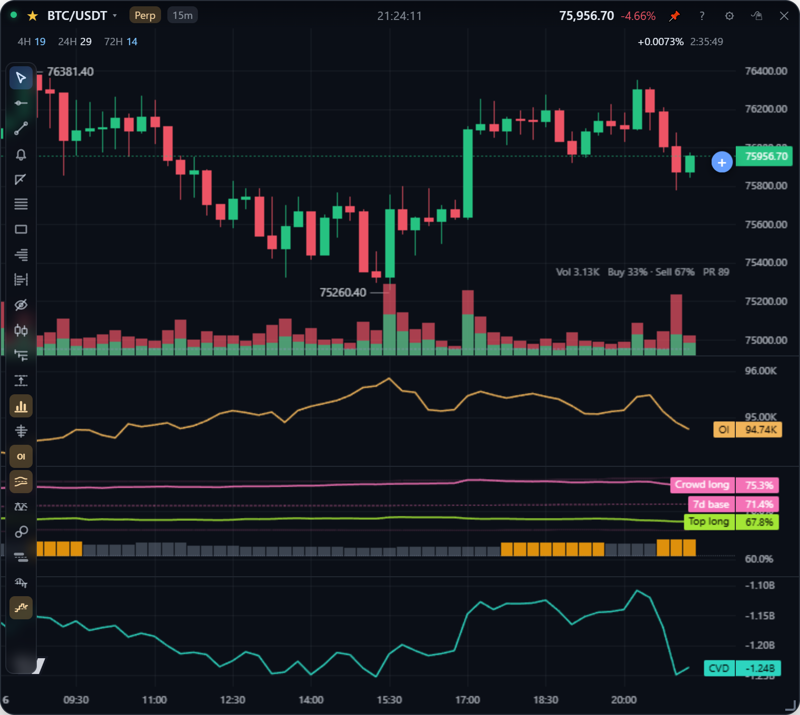
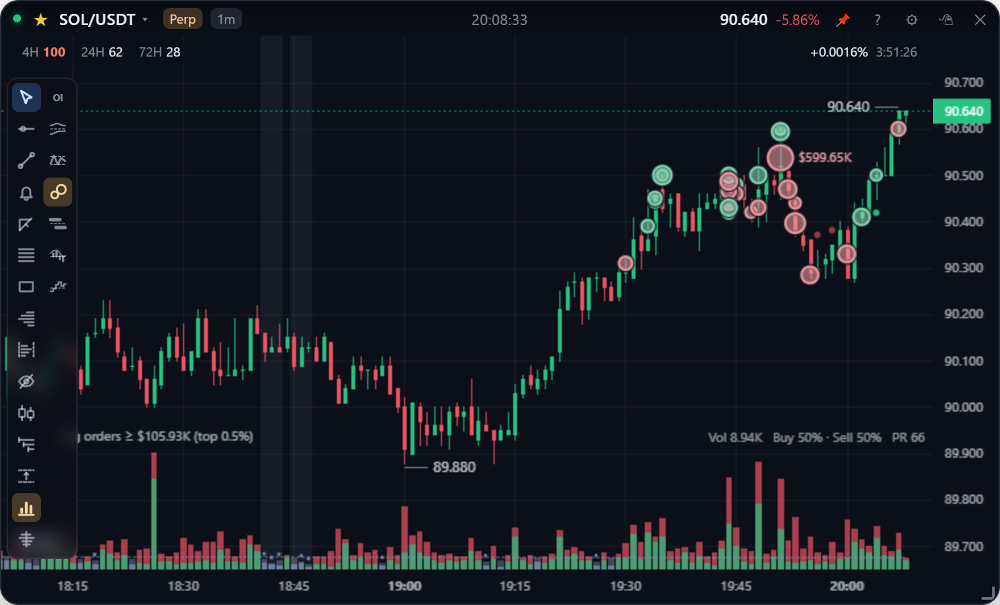
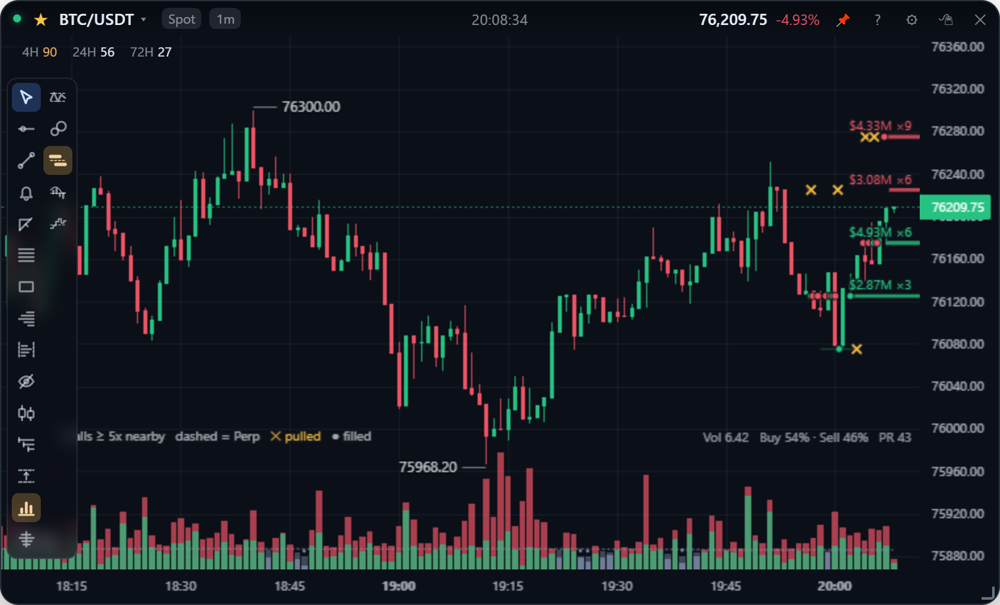
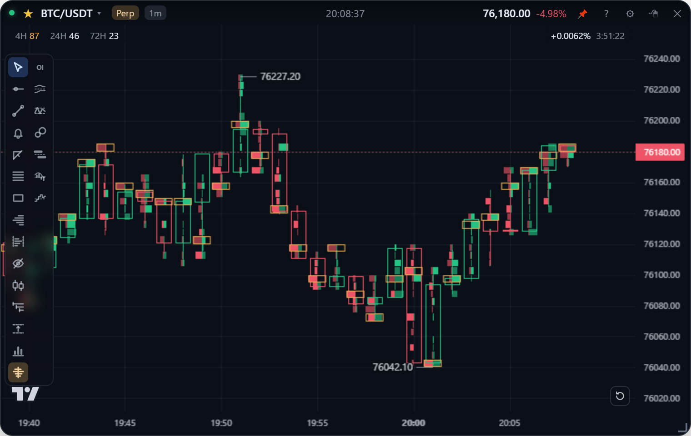

[English](order-flow.md) | **繁體中文**

# 訂單流

誰在交易、力道多大：主動買賣拆分的成交量、CVD、未平倉量、多空比、大單、倉位判讀、掛單牆和足跡圖。全部來自幣安的公開資料，免費、不需要 API Key。

| 工具 | 現貨 | 永續 | 工具列圖示 |
| --- | :---: | :---: | --- |
| [成交量](#成交量) | ✓ | ✓ | 直條 |
| [CVD](#cvd) | ✓ | ✓ | 階梯 |
| [未平倉量](#未平倉量-oi) | | ✓ | OI |
| [多空比](#多空比) | | ✓ | 兩條曲線 |
| [大單](#大單) | ✓ | ✓ | 兩顆泡泡 |
| [倉位判讀](#倉位判讀) | | ✓ | 兩顆泡泡 |
| [掛單牆](#掛單牆) | ✓ | ✓ | 兩條橫槓 |
| [足跡圖](#足跡圖) | ✓ | ✓ | 中間一條直線、左右各一排橫條 |

## 成交量

**直條**圖示打開成交量的選單：關閉 / 顯示成交量，以及：

- **顏色**：「主動買／賣拆分」把每根量拆成主動買（下）和主動賣（上）；「跟 K 棒同色」則整根跟著 K 棒紅綠。
- **位置**：「疊在 K 線圖底部」（預設，像 TradingView，K 線保有整張卡片的高度）或「獨立副圖」。
- **縮量門檻 PR ≤**：已收盤 K 棒的成交量（USDT）在它之前那些 K 棒裡排在這個百分位以下時畫成灰色，冷清的 K 棒一眼就看得出來。用百分位排名而不是「低於平均的一半」，因為一根爆量可能是平常的 10～50 倍，會把平均值拉著跑。
- **分布記憶長度**：這個分布大約記住多少根 K 棒，更舊的會逐漸淡出。

## CVD

**階梯**圖示：關閉 / 顯示 CVD，以及從哪裡開始累加。

- **從載入的第一根 K 棒**：只看形狀，也就是買盤有沒有跟上價格。
- **每天 0 點歸零**（UTC，台灣 08:00）：數值就是當天的淨買賣，有一條零軸虛線，每天的線分開畫。

CVD（累積成交量差）是逐根加總「主動買入 − 主動賣出」。幣安每根 K 棒都附主動買入量，所以免費，現貨和永續都有。每根的差額用該根均價換成 USDT，跟成交量柱一致（與幣安精確的主動買入額相差約 1% 以內）。即時逐筆更新；舊快取裡沒有主動買入量的 K 棒不計入。

## 未平倉量 (OI)

**OI** 圖示（或在設定勾「顯示未平倉量 (OI) 副圖 · 永續」）在下方加一個橘色副圖，單位是幣（例如 `94.90K` 顆 BTC），約每 3 秒更新。現貨卡片會保留這個設定，切回永續時再顯示。

幣安的 OI 只有快照和最多 30 天的 5 分鐘歷史，所以只要有永續卡片開著，App 就會自己記錄，不管副圖有沒有打開。只要至少每 30 天開一次 App，歷史就會累積得比交易所的還長。儲存方式見[資料儲存](../design/storage.zh-TW.md#未平倉量)。

## 多空比

**兩條曲線**圖示打開選單：關閉 / 顯示、要畫哪些線，以及單位。

| 線 | 顏色 | 意思 |
| --- | --- | --- |
| 散戶 | 粉紅 | 有倉位的帳戶裡，淨做多的有多少，每個帳戶算一次，大多是散戶 |
| 大戶 | 綠 | 保證金前 20% 的帳戶，依持倉量計算 |

**單位：做多占比 %（預設）**。每條線都是做多的比例：多空比 3 就是 75%。比值越高越會被放大（2 → 3 看起來多了一半，其實只是做多帳戶從 67% 變成 75%），所以改看比例，變化才是真實的大小。散戶那條線還多了：

- **7 天基準**（虛線）和**基準帶**（點線）：散戶做多占比在過去一週的中位數，以及上下各兩倍的穩健離散度。散戶有自己的固定水位（一個月內 BTC 很少離開 48%～76%、ETH 很少離開 65%～80%），所以有意義的是離平常多遠，不是數字本身。
- **底部的柱子：價格解釋不了的部分**。以一天來看，散戶大多是價格的鏡子：跌了就加多、漲了就平多。柱子是散戶 24 小時的變化裡，24 小時價格變化解釋不了的那一部分，單位是標準差：**+2σ 以上是琥珀色**（比跌幅能解釋的還要偏多很多，是真正的擁擠），**−2σ 以下是藍色**（以這段走勢來說異常地不做多），中間是灰色。每一小時都需要前十天的資料，所以 30 天裡最早那一段沒有柱子。

兩者都只用該小時之前的資料擬合，所以畫出來的歷史就是當時會顯示的樣子。不管卡片是什麼週期，都是每小時一筆、每小時更新。

> **怎麼看**：急跌之後散戶遠高於基準，通常只是在接刀；在 BTC 最近 30 天的資料裡，這種情況之後反彈的次數跟下跌差不多。琥珀色的柱子代表散戶比「接刀」還要更偏多，這才是清算行情的燃料；高點附近出現藍色柱子，代表散戶開始轉向，那個月的幾次下跌之前都出現過。它是看訂單流時的背景資訊，單獨拿來當訊號不夠。細節與實測見[分析指標](../design/analytics.zh-TW.md#散戶的相對位置)。

**單位：多空比**。交易所的兩個原始比值，共用一個座標，虛線 1.0 代表多空相當。

數據是幣安公開的交易統計：每 5 分鐘一筆，保留最近 30 天，只有永續合約有（現貨卡片不顯示這個圖示）。每根 K 棒畫的是它**收盤那一刻**的讀數，正在形成的那根用最新的讀數。比 5 分鐘短的 K 棒沿用最近一筆；30 天以前或沒有取樣的時段留白，不會畫成平線。

同樣這兩個數字和資金費率也在下單票上，見[下單](trading.zh-TW.md#多空傾向)。

## 大單

**兩顆泡泡**圖示：關閉 / 大單 / 倉位判讀 / 兩者。

同一毫秒的主動成交合併成一張單。排在**該幣種自己最近訂單**前 0.5%～0.01%（在選單裡選）的，以泡泡畫在它的成交均價上，綠色是買、紅色是賣，大小依金額，最大的會標出金額。左下角圖例顯示這個門檻目前等於多少 USDT（ETH 前 0.1% 約 $30～80 萬，ADA 約 $5 萬）。

用排名而不是固定金額，是因為同一個金額在 ETH 一小時有好幾張，在 ADA 可能一張都沒有。大單只在 App 開著、而且有卡片顯示大單時才會收集；事後補資料等於要下載所有逐筆成交。細節見[分析指標](../design/analytics.zh-TW.md#大單與倉位判讀)。

## 倉位判讀

永續上，ΔOI 達到中位數 2 / 3 / 5 倍的 K 棒會標上：

| 標籤 | 主動方 | OI | 判讀 |
| --- | --- | --- | --- |
| **新多** | 買 | 增加 | 多單進場 |
| **新空** | 賣 | 增加 | 空單進場 |
| **空補** | 買 | 減少 | 空單回補 |
| **多平** | 賣 | 減少 | 多單平倉 |

滑鼠移到 K 棒上可以看到它的 ΔOI、主動淨量、判讀和最大單。OI 只有在成交雙方都開倉（增加）或都平倉（減少）時才會變，所以 ΔOI 說明開了或平了多少，主動方向說明積極的一方偏向哪邊。只有 OI 在 K 棒內有取樣的才會判讀，也就是 App 有在執行的時段；同一根 K 棒裡的開倉和平倉會互相抵消。

## 掛單牆

**兩條橫槓**圖示：關閉 / 本市場的掛單簿 / 現貨＋永續。

比附近價位大很多（5 / 10 / 20 倍，在選單裡選）的掛單，從它出現的時間起畫成一條價位線，綠色是買單、紅色是賣單，越大越粗，並標上金額和倍數。選「現貨＋永續」時，另一個市場的牆是虛線並加上標籤。

牆消失時會留下一段淡線，結尾標示：

- 琥珀色 **✕**：價格還沒到就消失，是**撤單**；
- **圓點**：價格碰到才消失，是**被吃掉**。

永續的掛單簿約需一分半鐘才會補齊，期間圖例會顯示同步中。存在不到十秒的牆不記錄，因為價格附近的造市商每幾秒就會重新報價。牆是怎麼找出來的，見[分析指標](../design/analytics.zh-TW.md#掛單牆)。

## 足跡圖

工具列的**足跡圖**圖示（中間一條直線、左右各一排橫條）→「顯示足跡圖」。

- 每根 K 棒裡依價位畫出**主動賣（左，下跌色）**和**主動買（右，上漲色）**。K 棒改成空心，橘框是這根成交最多的價位（POC），圖表底部是每根的 **Delta**（主動買 − 主動賣）。
- K 棒寬度不到 72px 時畫成左右兩排橫條；放大到 72px 以上改成每列「`賣 買`」數字，底色深淺代表量。
- **失衡**（某價位的主動買 ≥ 下一格主動賣的 N 倍，或主動賣 ≥ 上一格主動買的 N 倍）畫成實色或粗體，倍數在選單裡選 2 / 3 / 4 倍。
- 選單的「**放大到最近 30 根**」一鍵把最近 30 根撐滿畫面。
- 涵蓋最近 30 根（最多 6 小時）。開啟時從存檔讀回、缺的從交易所補最近 3 小時，由新往舊；還沒補齊的 K 棒畫淡，Delta 前面加 `~`。

跟成交量分布不同，足跡圖是精確值，因為它是用每一筆成交算的。補資料會讓給下單，因為兩者共用同一個請求額度。完整設計見[足跡圖](../design/footprint.zh-TW.md)。
