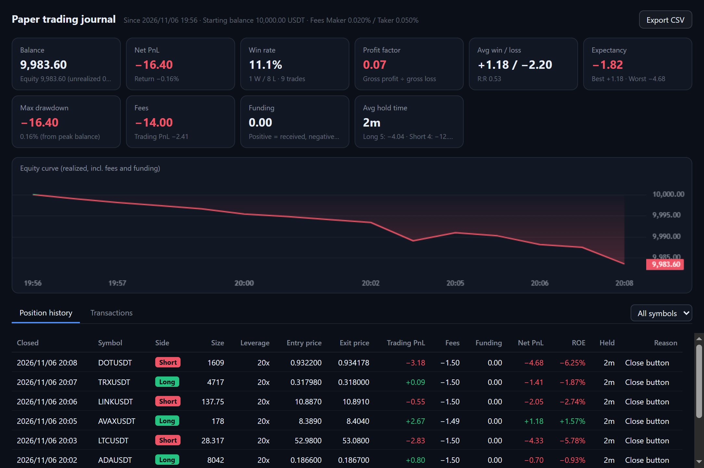

**English** | [繁體中文](paper-trading.zh-TW.md)

# Paper trading

A local practice account for testing a strategy and seeing how good you really are: a **starting balance you choose**, matched against **Binance's live market data**, with fees, funding and slippage applied and every closed position recorded. No API key needed.

## Setup

Right-click a card → Settings → Trading → set Environment to "**Paper (local)**".

- **Starting balance.** Enter an amount → "Restart with this amount…" → confirm. Restarting clears paper positions, orders and history; **the old history is backed up** as `userData/paper-account-<time>.json`.
- **Fees.** Maker / taker rates, 0.02% / 0.05% by default (a regular Binance account). Change them to yours if you have a VIP tier or the BNB discount.
- **Trade journal & performance** opens the journal window.

The order ticket, TP / SL, reverses, drag to reprice and the default amount all work as in [Trading](trading.md); the cards are badged "Paper". The paper exchange answers the same calls as Binance's API, so the trading code has no second path anywhere.

## How fills and costs are computed

As close to reality as possible, erring conservative:

| Item | How |
| --- | --- |
| Fees | Notional of each fill × rate. **A resting limit order that fills is maker**; market orders, triggered TP / SL and limit orders that fill as soon as they're sent are **taker** |
| Slippage | Market orders and TP / SL **eat through Binance's real order book** (top 50 levels) level by level for their average price: the bigger the order and the thinner the coin, the more slippage |
| Limit fills | A real trade has to **cross** the limit price. Merely touching it doesn't count, since in reality you would be waiting in the queue and might not be filled |
| TP / SL | Triggered by the **mark price**, as live, then closed at market against the book |
| Funding | At each settlement, paid or received at Binance's published rate × mark price: when the rate is positive, longs pay and shorts receive |
| Liquidation | Cross margin: when balance + unrealized PnL ≤ maintenance margin, every position is liquidated at the mark price and the remaining maintenance margin is taken as the fee. The balance never goes negative |
| Leverage brackets | Without an API key the per-symbol brackets can't be read, so every symbol uses BTCUSDT's (max 125x) |

**While the app is closed.** A real exchange does not stop filling orders when you turn your computer off, so neither does this one. The next time the app opens, the gap (up to 30 days) is replayed from **1m bars and Binance's published funding rates**: stops, limit fills, take-profits, funding and liquidations are processed in time order, and a notice reports the result. Within one minute it can't tell whether the high or the low came first, so **stop losses are evaluated before take-profits**.

## The journal

| Section | Contents |
| --- | --- |
| Performance | Balance and equity, net PnL and return, win rate, profit factor (gross profit ÷ gross loss), average win / loss, expectancy per trade, best / worst trade, max drawdown from the balance peak, total fees and funding, average holding time, and longs and shorts separately |
| Equity curve | The balance after each change (realized PnL, fees, funding): green above the starting balance, red below |
| Open positions | Positions not yet closed, with the fees and funding paid on them so far |
| Position history | One row per position from open to fully closed: side, max size, leverage, average entry / exit, price PnL, fees, funding, **net PnL**, ROE, holding time and why it closed (Manual / Close button / Limit / TP / SL / Reverse / Liq.). Filterable by symbol |
| Transactions | Every deposit, realized PnL, fee and funding payment with the balance after it |
| Export CSV | Saves the position history as a CSV that opens in Excel |

A **reverse** is two rows: the old position closed with reason "Reverse", and the new one opened at the same price, with the fee split between them in proportion to size.
