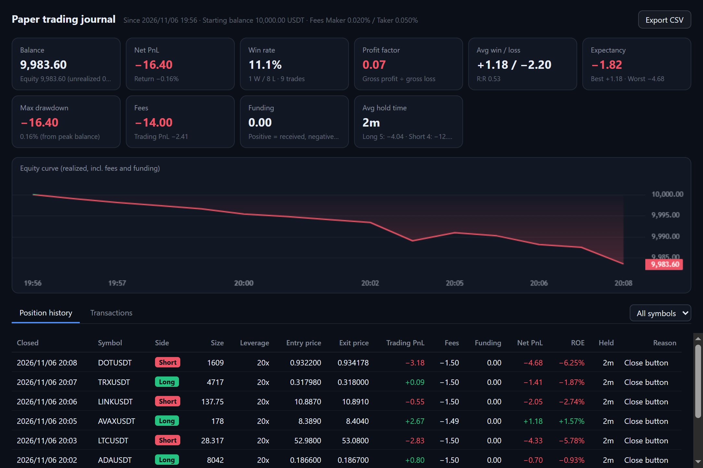

[English](paper-trading.md) | **繁體中文**

# 模擬交易

本機的練習帳戶，用來測試策略、看自己真正的實力：**自訂初始資金**，用**幣安正式市場的即時行情**撮合，手續費、資金費、滑價都算進去，每一筆平倉都留紀錄。不需要 API Key。

## 設定

在卡片上按右鍵 → 設定 → 交易 → 環境選「**模擬（本機）**」。

- **初始資金**：輸入金額 →「用這個金額重新開始…」→ 確定。重新開始會清空模擬倉位、掛單與紀錄，**舊紀錄會另存備份**（`userData/paper-account-<時間>.json`）。
- **手續費**：Maker / Taker 費率，預設 0.02% / 0.05%（幣安一般用戶）。有 VIP 或 BNB 折抵就改成自己的費率。
- **交易紀錄與績效**：打開紀錄視窗。

下單票、止盈止損、反手、拖曳改價和預設金額都跟[下單](trading.zh-TW.md)一樣能用，卡片上標示「模擬」。模擬交易所回應的是跟幣安 API 相同的呼叫，所以交易程式不需要分兩套。

## 成交與成本怎麼算

盡量貼近真實，寧可保守：

| 項目 | 怎麼算 |
| --- | --- |
| 手續費 | 每筆成交的名目價值 × 費率。**掛著的限價單成交算 Maker**；市價單、觸發的止盈止損、一送出就成交的限價單算 **Taker** |
| 滑價 | 市價單和止盈止損**吃幣安真實的掛單簿**（前 50 檔），一檔一檔往下吃算成交均價：單子越大、幣越冷門，滑價越多 |
| 限價成交 | 要有真實成交價**穿過**掛單價才算成交。只碰到不算，因為真實情況要排隊，不一定輪得到你 |
| 止盈止損 | 以**標記價格**觸發（跟正式環境一樣），觸發後市價吃掛單簿平倉 |
| 資金費率 | 每次結算時以幣安公布的費率 × 標記價格收付：費率為正時多單付、空單收 |
| 強平 | 全倉：資金 + 未實現損益 ≤ 維持保證金時，全部倉位以標記價格強平，剩下的維持保證金當作清算費。資金不會變負的 |
| 槓桿分層 | 沒有 API Key 讀不到各幣種的分層，所以全部共用 BTCUSDT 的分層（最高 125x） |

**程式關著的時候**：真實交易所不會因為你關電腦就不成交，所以模擬也不會停。下次開程式時，會用 **1 分 K 與幣安公布的資金費率**把關閉期間補算一遍（最多 30 天）：止損、限價成交、止盈、資金費、強平依時間順序處理，算完跳提示。同一分鐘內不知道先到高點還是低點，所以**先算止損、再算止盈**。

## 紀錄視窗

| 區塊 | 內容 |
| --- | --- |
| 績效 | 目前資金與淨值、淨損益與報酬率、勝率、盈虧比（總獲利 ÷ 總虧損）、平均獲利 / 平均虧損、每筆期望值、最好 / 最差一筆、從資金高點算的最大回撤、手續費與資金費總計、平均持倉時間，以及多單與空單分開的成績 |
| 資金曲線 | 每一次資金變動（已實現損益、手續費、資金費）後的餘額：高於初始資金是綠色、低於是紅色 |
| 持倉中 | 還沒平倉的倉位，以及到目前為止付了多少手續費和資金費 |
| 歷史倉位 | 從開倉到完全平倉算一筆：方向、最大數量、槓桿、開倉 / 平倉均價、價差損益、手續費、資金費、**淨損益**、ROE、持倉時間、平倉原因（手動 / 平倉鍵 / 限價 / 止盈 / 止損 / 反手 / 強平）。可以只看單一幣種 |
| 資金明細 | 每一筆入金、已實現損益、手續費、資金費和當時的餘額 |
| 匯出 CSV | 把歷史倉位存成 Excel 打得開的 CSV |

**反手**在紀錄裡是兩筆：原倉位以「反手」平倉，新倉位從同一個價格開始，手續費按數量比例分給兩筆。
