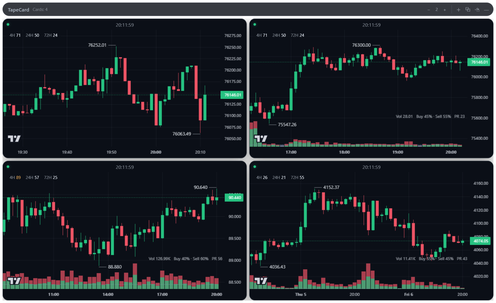
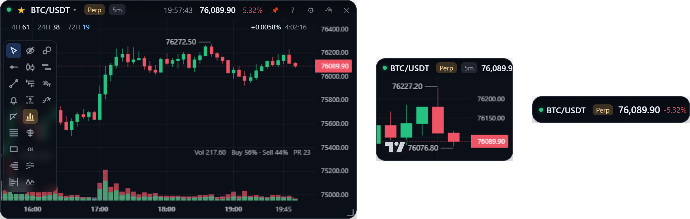
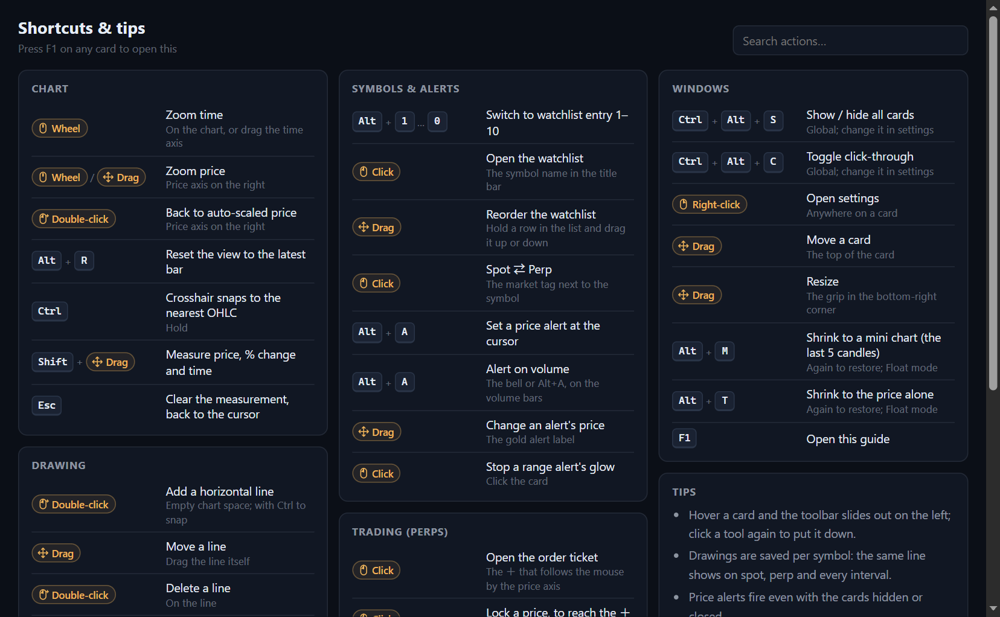

**English** | [繁體中文](windows.zh-TW.md)

# Cards & windows

How the cards live on your desktop: the two display modes, moving and shrinking cards, click-through, showing and hiding them all, the tray, settings and shortcuts.

## Float and Board

- **Float** (the default): each card is its own frameless, translucent window, placed anywhere on screen and optionally always on top.
- **Board**: one window with the cards in a grid. Drag a card's title bar to reorder; set the column count at the top right.

Switch with tray menu → "Display Mode". Both modes share the same card settings, so switching never loses a card's symbol, interval, chart type or opacity.

## Moving and sizing a card

| Action | How |
| --- | --- |
| Move | Drag the top of the card (the title bar appears on hover) |
| Resize | Drag the grip in the bottom-right corner |
| Add / remove cards | Tray menu, or the ＋ in Board mode's title bar |
| Opacity | Settings → the opacity slider (the card background's alpha) |

Positions and sizes are saved half a second after you stop moving. At startup, saved positions are checked against the current screens and cards are pulled back into view if the layout changed.

## Mini chart and ticker

With a card active, `Alt+M` shrinks it to a **mini chart** (the last 5 candles and the price; no time axis, volume or OI) and `Alt+T` to a **ticker** strip (symbol, live price and 24h change). The same key again, or the **⤢** that shows on hover, brings the full card back where it was. Each small form remembers where you last dragged it, and the form survives a restart. Float mode only.

## Showing, hiding and click-through

| Action | How |
| --- | --- |
| Show / hide every card | `Ctrl+Alt+S` (global), or left-click the tray icon. If any card is missing, for example minimized by another program, one press always **shows**; it never hides the others first |
| Click-through | `Ctrl+Alt+C` (global), or the tray menu. Clicks go straight through to the desktop |
| Leave click-through | Hover the small "Exit click-through" button in the card's bottom-right corner, or press `Ctrl+Alt+C`. You can't lock yourself out |

Both global shortcuts can be changed under Settings → Global settings.

Cards stay out of the taskbar and are managed from the tray. Because a minimized card would then have no button to bring it back, cards can't be minimized: if `Win+M` or another program minimizes one, it is restored at once. Always-on-top is put back whenever Windows strips it.

## Settings

| Action | How |
| --- | --- |
| Open | The gear button, or right-click the card |
| Close | `Esc`, right-click again, or ✕ at the top right of the panel |

The panel holds the card's own settings (symbol, market, interval, chart type, opacity, time zone, panes) and, under "Global settings", those shared by every card: language, title-bar clock, global shortcuts, range-alert levels and [trading](trading.md#setup).

Settings live in `%APPDATA%/stock-card/stock-card-config.json`. The folder keeps the app's old name, so the development and installed builds share it. More in [Storage](../design/storage.md#settings).

## Shortcuts & tips

Press **`F1`** on a card (or **?** in its title bar, or tray menu → "Shortcuts & tips") for a one-page cheat sheet of every key and gesture, grouped by what you are doing: reading the chart, drawing, symbols & alerts, trading and windows. Type to filter it. The two global shortcuts show as you have set them.

## Known limitations

- **The background can't blur the desktop.** CSS `backdrop-filter` only blurs what is in the same page, and behind a transparent window is the desktop. Real frosted glass needs Windows' DWM acrylic API (native code). The translucency is the card background's alpha, which is what the opacity slider changes.
- **Transparent windows can't be maximized** on Windows, so there is no maximize.
- **"Launch at startup"** only works in the installed build; in development it would point at `electron.exe`.
- **"Encrypted DNS"** in the tray menu (on by default) looks up the market-data hosts with Cloudflare or Google over HTTPS, for networks that block Coinbase at the DNS step. See [Coinbase premium](order-flow.md#coinbase-premium).
- The TradingView logo at the bottom left of the chart is Lightweight Charts' attribution and is kept.

A card disappeared? [Vanishing cards](../troubleshooting/vanishing-cards.md) lists every case met so far, how to tell which one it is and how to fix it.
