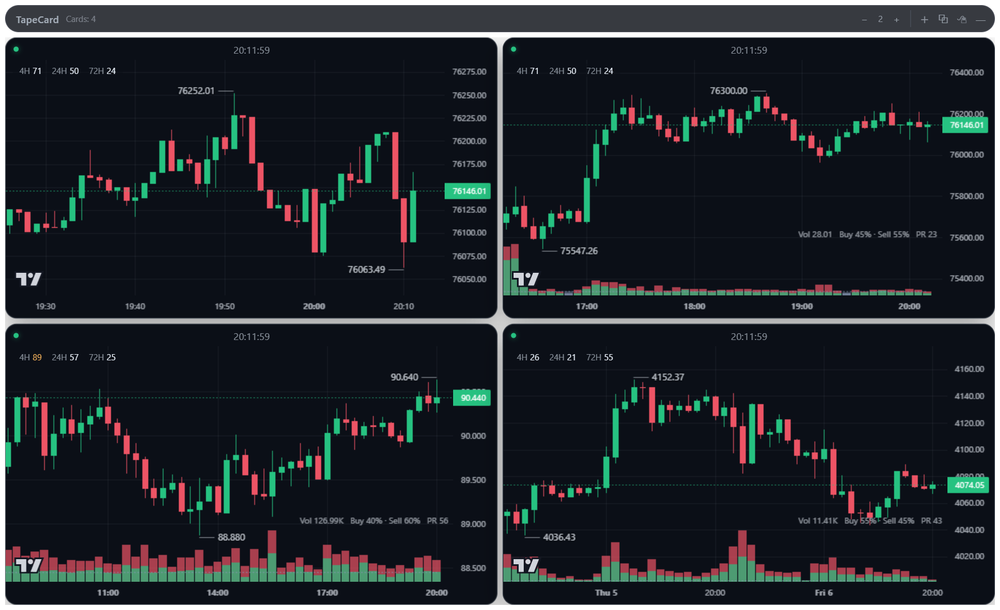
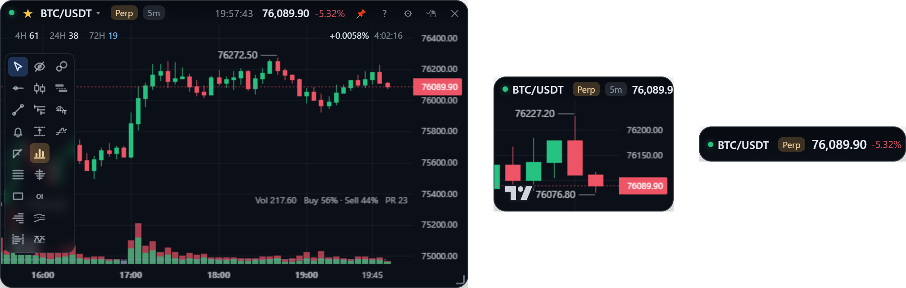
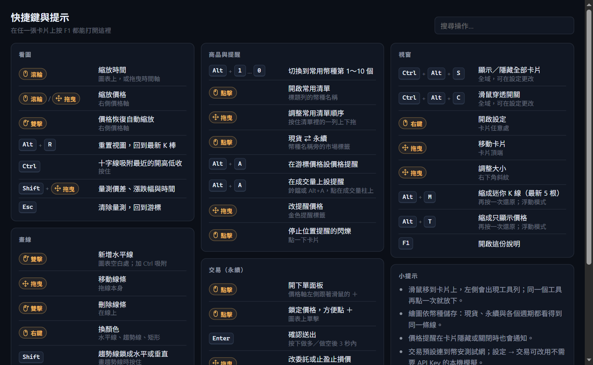

[English](windows.md) | **繁體中文**

# 卡片與視窗

卡片怎麼放在桌面上：兩種顯示模式、移動與縮小卡片、滑鼠穿透、全部顯示或隱藏、系統匣、設定和快捷鍵。

## Float 與 Board

- **Float**（預設）：每張卡片各自是一個無邊框、半透明的視窗，可以擺在螢幕任何地方，也可以置頂。
- **Board**：單一視窗，卡片排成格狀。拖曳卡片標題列可以重新排序，右上角可以調欄數。

從系統匣選單 →「顯示模式」切換。兩種模式共用同一份卡片設定，來回切換不會遺失卡片的幣種、週期、圖型或透明度。

## 移動與調整卡片

| 動作 | 方式 |
| --- | --- |
| 移動 | 拖曳卡片頂端（滑鼠移上去標題列才會浮現） |
| 調整大小 | 拖曳右下角的斜線把手 |
| 新增 / 移除卡片 | 系統匣選單，或 Board 模式標題列的 ＋ |
| 透明度 | 設定 → 透明度滑桿（卡片背景的透明度） |

位置與大小在停止移動半秒後寫入。啟動時會檢查存下來的座標是否還在現有螢幕範圍內，螢幕配置變了會自動把卡片拉回可見區域。

## 迷你 K 線與價格條

在卡片上按 `Alt+M` 縮成**迷你 K 線**（最新 5 根 K 線和價格，不顯示時間軸、成交量、OI）；按 `Alt+T` 縮成**價格條**（幣種、即時價格和 24h 漲跌）。再按同一個鍵，或滑鼠移上去出現的 **⤢**，就回到原本大小和位置。兩種小樣式各自記得你上次拖到哪裡，重開 App 也會維持。只在 Float 模式可用。

## 顯示、隱藏與滑鼠穿透

| 動作 | 方式 |
| --- | --- |
| 顯示 / 隱藏全部卡片 | `Ctrl+Alt+S`（全域），或左鍵點系統匣圖示。有卡片不見時（例如被別的程式最小化），按一下一定是**顯示**，不會先把其他卡片藏起來 |
| 滑鼠穿透 | `Ctrl+Alt+C`（全域），或系統匣選單。點擊會直接穿到桌面 |
| 解除穿透 | 滑鼠移到卡片右下角的「解除穿透」小鈕，或按 `Ctrl+Alt+C`，不會把自己鎖在外面 |

兩個全域快捷鍵都可以在設定 → 全域設定裡改。

卡片不出現在工作列，一律由系統匣管理。也因此卡片被最小化就沒有按鈕可以點回來，所以卡片不能最小化：`Win+M` 或其他程式把它縮下去時會立刻恢復。Windows 拿掉置頂時也會自動放回去。

## 設定

| 動作 | 方式 |
| --- | --- |
| 打開 | 齒輪鈕，或在卡片上按右鍵 |
| 關閉 | `Esc`、再按一次右鍵，或面板右上角 ✕ |

面板裡是這張卡片自己的設定（幣種、市場、週期、圖型、透明度、時區、副圖），以及「全域設定」裡所有卡片共用的：語言、標題列時鐘、全域快捷鍵、位置提醒等級和[交易](trading.zh-TW.md#設定)。

設定存在 `%APPDATA%/stock-card/stock-card-config.json`。資料夾沿用舊名，所以開發版和安裝版共用同一份。更多見[資料儲存](../design/storage.zh-TW.md#設定)。

## 快捷鍵與提示

在卡片上按 **`F1`**（或標題列的 **?**、系統匣選單 →「快捷鍵與提示」），打開一頁式的快捷鍵總表：看圖、畫線、商品與提醒、交易、視窗，按你正在做的事分類，打字就能篩選。兩個全域快捷鍵會顯示你自己設定的組合。

## 已知限制

- **背景模糊不到桌面。** CSS 的 `backdrop-filter` 只能模糊同一個網頁裡的東西，而透明視窗背後是桌面。真正的毛玻璃要呼叫 Windows DWM 的 acrylic API（原生程式）。目前的半透明效果來自卡片背景的透明度，也就是透明度滑桿實際在調的東西。
- **透明視窗不能最大化**，這是 Windows 的限制，所以沒有提供最大化。
- **「開機自動啟動」** 只在安裝版有效；開發模式下會指向 `electron.exe`。
- 圖表左下角的 TradingView 標誌是 Lightweight Charts 的署名，保留著。

卡片不見了？[卡片消失排查](../troubleshooting/vanishing-cards.zh-TW.md)列出目前遇過的每一種情況、怎麼判斷是哪一種、怎麼修。
